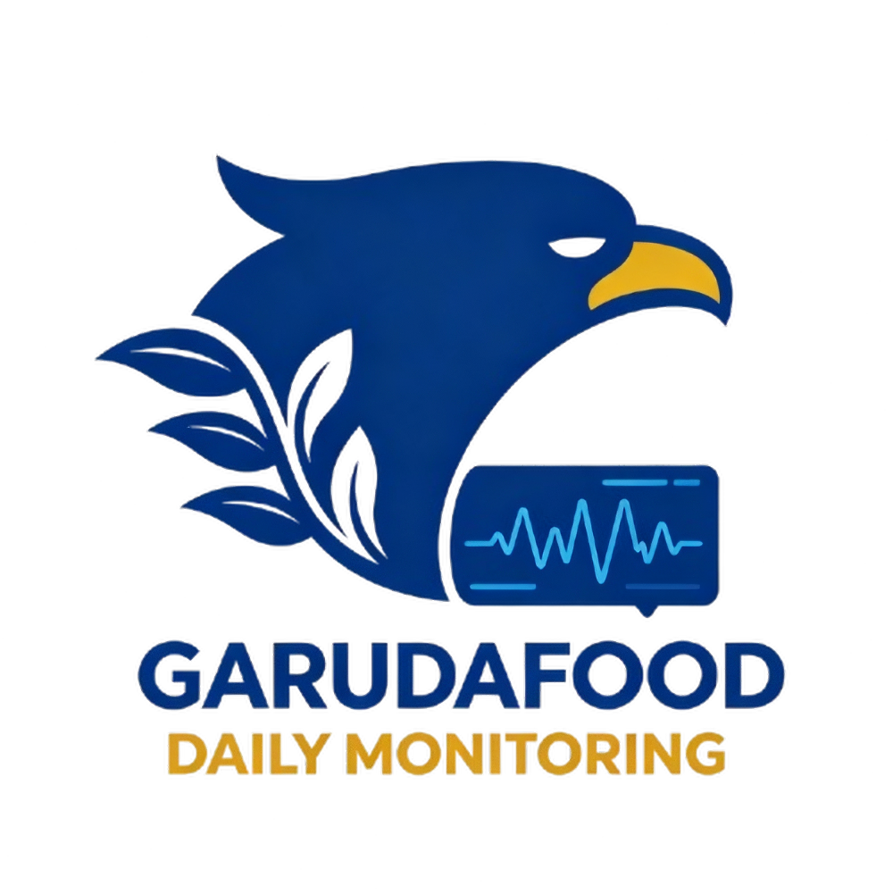
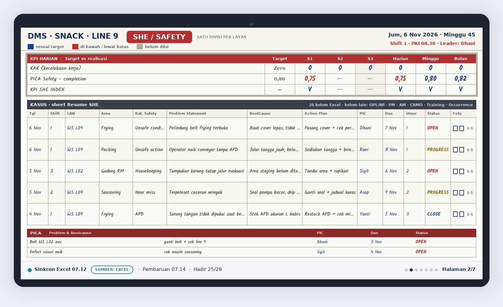
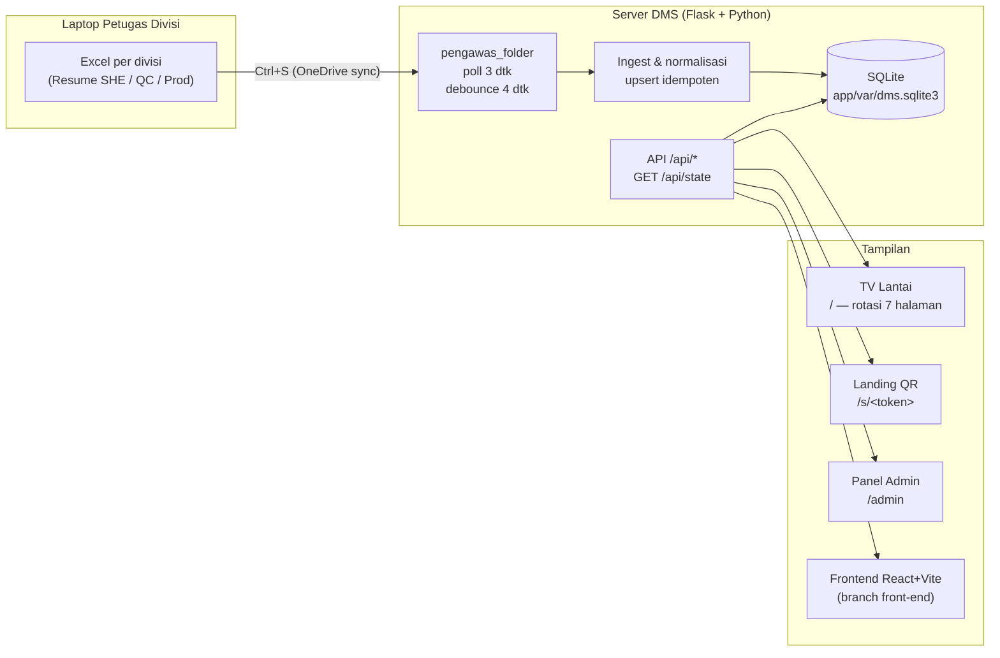

<div align="center">



# DMS — Daily Monitoring System

### Digitalisasi papan monitoring harian pabrik: satu kali isi di Excel, semua layar membaca angka yang sama.

[](https://www.python.org)
[](https://flask.palletsprojects.com)
[](https://www.sqlite.org)
[](https://react.dev)
[](https://vite.dev)
[](#-status-proyek)
[](docs/README.md)

</div>

---

## 📌 Kenapa DMS Digital?

Setiap pagi, papan DMS diisi **manual**, lalu direkap ulang, lalu dibaca ulang di rapat — angka bisa beda di tiap papan. DMS digital menyelesaikan ini dengan prinsip sederhana:

> **Petugas tetap mengisi Excel seperti biasa (Ctrl+S). Aplikasi membaca Excel itu otomatis — tidak ada upload, tidak ada isi ulang, tidak ada langkah tambahan (Nol Langkah Tambahan).**

| 😕 Sebelum | 😄 Sesudah |
|---|---|
| Papan tulis / kertas, beda tiap line | TV per divisi, satu layar satu divisi (Satu Divisi per Layar) |
| Rekap manual, angka tak sinkron | Satu catatan, semua layar membaca sumber yang sama (Satu papan, satu catatan) |
| Absensi dikerjakan menyusul | Absensi jadi **gerbang** sebelum DMS (Absensi Dulu) |
| Berkas tercecer, susah ditelusuri | Semua tersimpan di SQLite + jejak audit |
| "Belum diisi" vs "belum tersinkron" tidak jelas | Dibedakan jujur (Status Berkas Jujur) |

---

## ✨ Fitur Utama

- 🖥️ **TV Lantai 7 halaman rotasi** — Absensi → SHE → Quality → Produksi → Delivery → Teknik → Ringkasan (satu divisi per layar, kolom mengikuti Excel)
- 🔐 **Absensi sebagai gerbang (Absensi Dulu)** — rotasi divisi terkunci sampai kehadiran dikonfirmasi; koreksi hanya lewat Supervisor/DH dengan alasan tercatat
- 📱 **QR sesi satu pintu (QR Satu Pintu)** — pindai di TV → landing ponsel: absensi → data divisi → review, satu tautan bertoken per shift
- 🔄 **Sinkron Excel otomatis, satu arah (Sinkron Excel Otomatis)** — pengawas folder (3 dtk) → ingest → TV menyegar ≤ 15 dtk; aplikasi **tidak pernah** menulis workbook (Kepemilikan Kolom)
- 📊 **KPI dihitung dari log kasus** — S1 · S2 · S3 · Harian · Minggu · Bulan (PICA completion rate, lewat tenggat, downtime)
- 🧽 **Tahan data kotor** — parser header bergeser (agnostik baris), tanggal 5 format, PIC berupa tautan → karantina & flag, bukan baris yang dibuang diam-diam
- 🛡️ **Jejak audit** — setiap ketukan absensi, konfirmasi, buka ulang sesi, dan sinkron tercatat di tabel `audit`
- 🚫 **Tidak ada upload untuk petugas** — cukup buka file yang sama + `Ctrl+S`; folder kerja dipindah ke OneDrive sekali oleh IT (junction di path lama)

---

## 🖼️ Sekilas Tampilan

<div align="center">


<br/><i>Halaman divisi (SHE): grid KPI S1–Bulan · tabel kasus dari <code>Resume SHE</code> · baris PICA terbuka</i>

</div>

---

## 🏗️ Arsitektur Singkat



Detail lengkap: **[docs/ALUR_APLIKASI_DMS.md](docs/ALUR_APLIKASI_DMS.md)** · **[docs/API_CONTRACT.md](docs/API_CONTRACT.md)** · **[docs/BACKEND_PLAN.md](docs/BACKEND_PLAN.md)**

---

## 🚀 Quick Start

```bash
# 1. Install dependency
pip install -r app/requirements.txt

# 2. Seed database (baca workbook di reference/ — read-only, tidak diubah)
python3 app/seed_demo.py

# 3. Jalankan server
python3 app/server.py        # → http://0.0.0.0:8000
```

| URL | Isi |
|---|---|
| `/` | 📺 TV lantai — rotasi 7 halaman |
| `/admin` | 🛠️ Panel sinkronisasi Excel (status sumber, karantina, jejak audit) |
| `/s/<token>` | 📱 Landing QR sesi (buka dari pindaian QR di TV) |
| `/api/state` | 🔌 State papan (JSON) — dipakai TV & frontend |
| `/healthz` | ❤️ Health check |

> 💡 Tekan **`S`** di TV untuk paksa sinkron, **`spasi`** untuk jeda rotasi, **`←/→`** pindah halaman, **`A`** ke Absensi.
> Frontend React ada di branch **`front-end`** — strukturnya dijelaskan di **[docs/FRONTEND_STRUCTURE.md](docs/FRONTEND_STRUCTURE.md)** (pohon folder, routing, komponen, data flow); kontrak API: [docs/API_CONTRACT.md](docs/API_CONTRACT.md).

---

## 📂 Struktur Repo

```
📦 DailyMonitoringSystem_App
├── 📱 app/                     ← BACKEND (Flask + Python) — inti ingest & API
│   ├── server.py               route (12 route) + pengawas folder
│   ├── dms_core.py             skema SQL · parser Excel · upsert · KPI
│   ├── seed_demo.py            seed awal (demo / produksi)
│   ├── registry.json           daftar sumber Excel (9 aktif · Delivery & Teknik menunggu)
│   └── setup_onedrive.ps1      pemasangan OneDrive + junction (sekali, oleh IT)
├── ⚛️  frontend/                 ← KERANGKA STRUKTUR (kosong, placeholder TODO)
│                              cermin scaffold branch front-end + FRONTEND_STRUCTURE.md;
│                              isi kode di branch front-end — bukan di sini
├── 🎨 Logo/                    ← Logo GARUDAFOOD Daily Monitoring (png + favicon)
├── 📚 docs/                    ← DOKUMENTASI (alur, kontrak API, rencana backend, laporan)
│   ├── ALUR_APLIKASI_DMS.md    peta alur lengkap (peran · halaman · fitur · user flow)
│   ├── API_CONTRACT.md         kontrak API v1 (pegangan frontend ↔ backend)
│   ├── BACKEND_PLAN.md         roadmap backend (Tahap A–D · SQLite → PostgreSQL)
│   ├── FRONTEND_STRUCTURE.md   struktur & penempatan frontend (panduan developer front-end)
│   └── laporan/                aturan sistem v1.1 (nama manusiawi, tanpa kode) · rancangan · deck
├── 📊 reference/               ← workbook acuan (read-only, sumber data asli)
└── 🖼️ Logo/ · docs/assets/     ← aset (mockup, papan asli, font Kalam)
```

---

## 📚 Dokumentasi

| Dokumen | Isi |
|---|---|
| [docs/ALUR_APLIKASI_DMS.md](docs/ALUR_APLIKASI_DMS.md) | 🗺️ Semua alur: role (12 kanonik, +PDCA/TL v1.1), landing QR, 2 dashboard, sinkron Excel, KPI, model data |
| [docs/API_CONTRACT.md](docs/API_CONTRACT.md) | 🔌 Kontrak endpoint: payload, response, enum, kode warna KPI, known gaps |
| [docs/BACKEND_PLAN.md](docs/BACKEND_PLAN.md) | 🛠️ Rencana backend: integrasi Vite, auth Entra ID, deploy, testing, milestone M0–M6 |
| [docs/FRONTEND_STRUCTURE.md](docs/FRONTEND_STRUCTURE.md) | ⚛️ Struktur & penempatan frontend: pohon folder, routing, komponen, data flow, checklist |
| [docs/README.md](docs/README.md) | 📑 Indeks seluruh dokumentasi & cara build deck |
| [docs/laporan/DMS_Aturan_Sistem_v1.md](docs/laporan/DMS_Aturan_Sistem_v1.md) | 📏 Aturan sistem v1.1 — nama manusiawi + komentar (status berkas jujur diperbaiki) |
| [docs/laporan/DMS_TV_PerDivisi_dan_Integrasi_Excel_v1.md](docs/laporan/DMS_TV_PerDivisi_dan_Integrasi_Excel_v1.md) | 📺 TV per divisi · QR satu pintu · sinkron Excel |

---

## 👥 Tim & Branch

| Branch | Pemilik | Isi |
|---|---|---|
| `arena/ca138dd1-dailymonitoringsystem-app` | Backend (kamu) | Backend Flask + dokumentasi |
| `front-end` | Frontend (teman) | React + Vite + ESLint (scaffold, integrasi menyusul) |
| `main` | Stabil | Merge target |

Alur kerja: backend ubah → perbarui `API_CONTRACT.md` di PR yang sama → frontend tarik & sesuaikan.
Detail di [docs/BACKEND_PLAN.md](docs/BACKEND_PLAN.md) §11.

---

## ✅ Status Proyek

| Item | Status |
|---|---|
| Ingest Excel (9 sumber, 15.940 kasus) | ✅ Jalan |
| TV 7 halaman + gerbang absensi (Absensi Dulu) | ✅ Jalan |
| QR sesi + landing `/s/<token>` | ✅ Jalan |
| Panel admin + jejak audit | ✅ Jalan |
| Delivery & Teknik | ⏳ Menunggu berkas Excel (halaman tampil "menunggu berkas", Kolom Statis, Isi Dinamis/Satu Berkas per Divisi) |
| Frontend React/Vite | ⏳ Scaffold sudah push di `front-end`; integrasi menyusul |
| Auth Entra ID / SSO | ⏳ Tahap C (lihat BACKEND_PLAN) |

---

## ⚖️ Aturan Kunci yang Mengikat

- **Absensi Dulu** Absensi dikerjakan lebih dulu, sebelum DMS · **QR Satu Pintu** QR sesi satu pintu
- **Sinkron Excel Otomatis** Integrasi Excel otomatis, satu arah, terus-menerus · **Nol Langkah Tambahan** Nol langkah tambahan bagi petugas
- **Kepemilikan Kolom** Kepemilikan kolom, bukan kepemilikan aplikasi · **Status Berkas Jujur** "belum diisi" ≠ "belum tersinkron"

---

<div align="center">


**Garudafood Group — DMS (Daily Monitoring System)**
<br/>Internal use · Boilerplate prototipe · Baca [docs/README.md](docs/README.md) untuk detail

</div>
