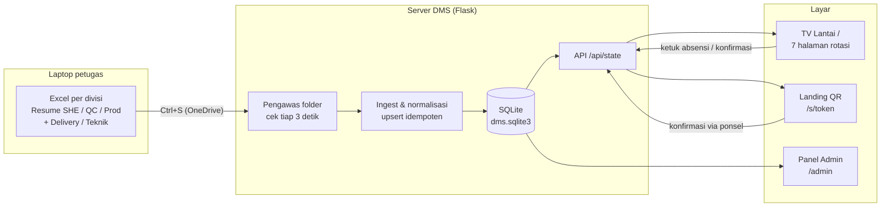
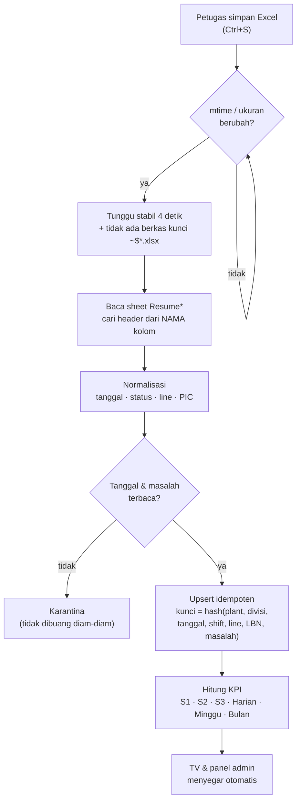
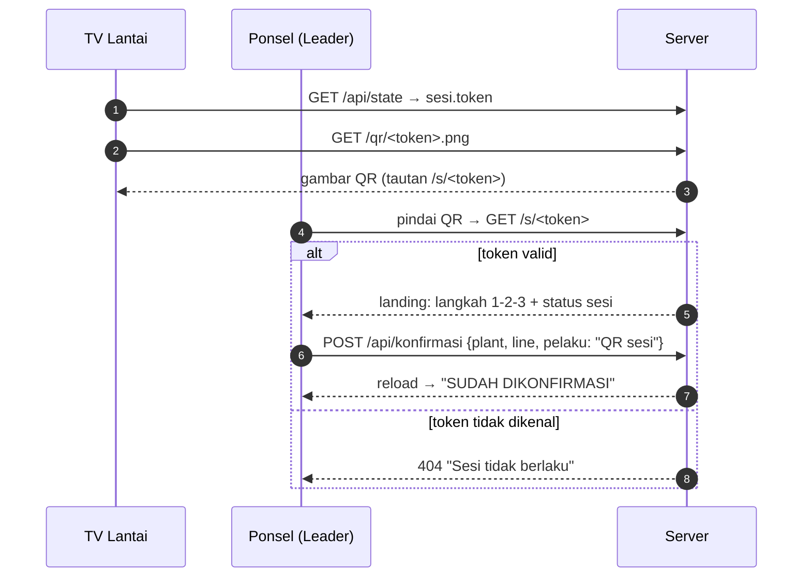
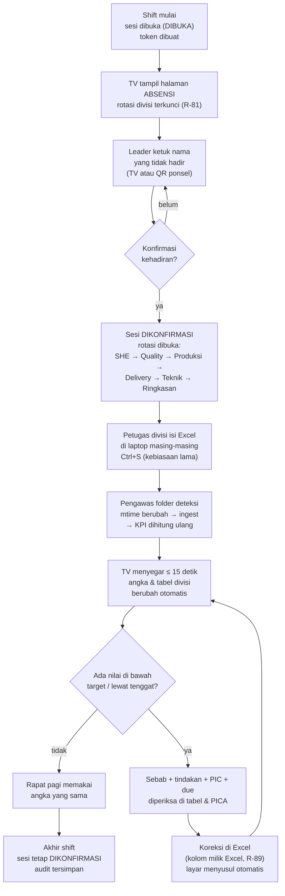
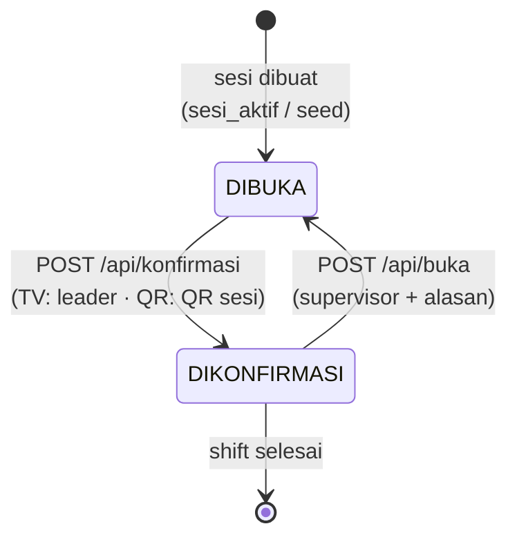
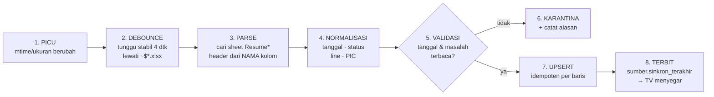
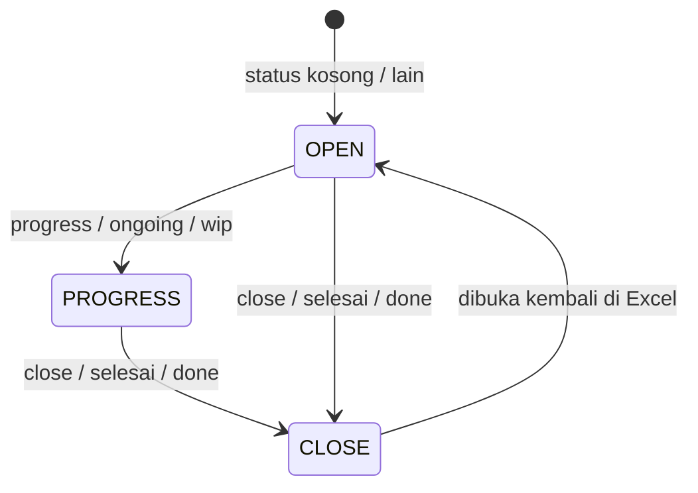
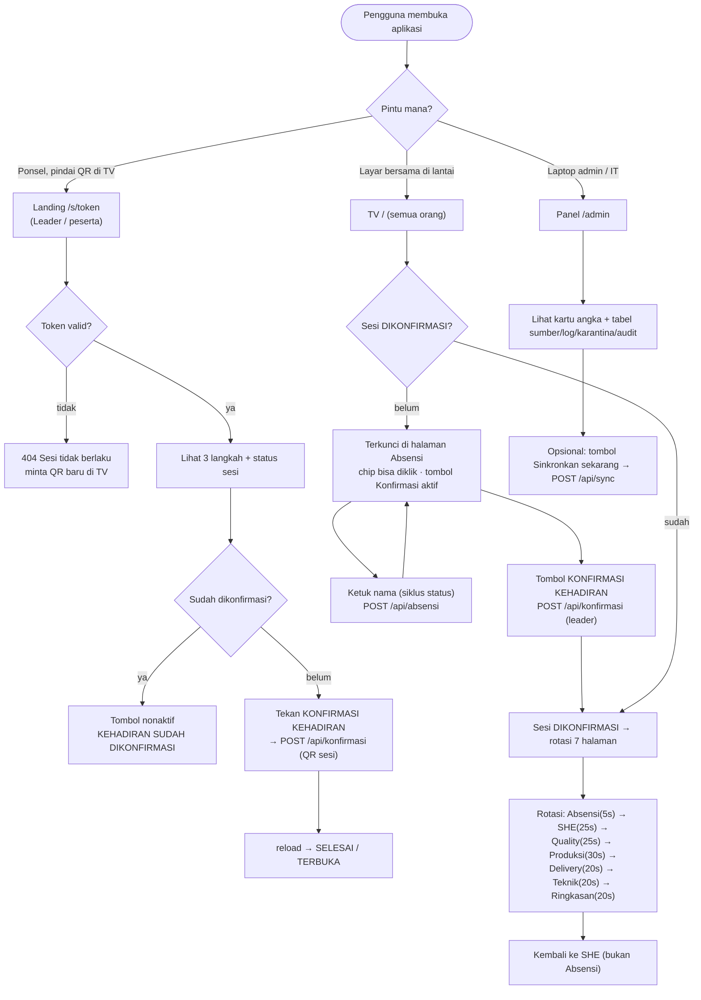

# DMS — Dokumentasi Alur Aplikasi

> **Daily Monitoring System (DMS) Digital — TV per divisi, absensi di awal, QR satu pintu, sinkron Excel otomatis**
>
> Dokumen ini adalah **peta alur aplikasi yang berjalan** (prototipe di `app/`), dibaca dari kode
> sumbernya — bukan rancangan di atas kertas. Untuk aturan baku dan rancangan target produksi,
> lihat dokumen rujukan di §16.
>
> Dokumen ini mencakup: **jumlah & definisi role**, **setiap menu/halaman dengan fitur lengkap
> (per elemen)**, **logic alur pengguna** dari awal shift sampai tutup, **sinkron Excel**, **KPI**,
> **model data**, dan **batasan prototipe vs produksi**.

| Item | Keterangan |
|---|---|
| Versi dokumen | v2 — 24 November 2026 |
| Status | Prototipe berjalan (`app/server.py` + `app/dms_core.py`) |
| Branch | `arena/ca138dd1-dailymonitoringsystem-app` |
| Stack | Python 3 · Flask · SQLite (`app/var/dms.sqlite3`) · openpyxl · qrcode · Pillow |
| Plant terdaftar | Snack · EP (Exist Plant) · NP (New Plant) |
| Divisi | SHE · Quality · Produksi · Delivery · Teknik |
| Sumber data | Workbook Excel per divisi di `reference/` (read-only) via `app/registry.json` |

---

## Daftar Isi

1. [Ringkasan & Tujuan](#1-ringkasan--tujuan)
2. [Ringkasan Angka (jumlah role, halaman, menu, dll)](#2-ringkasan-angka-jumlah-role-halaman-menu-dll)
3. [Peta Sistem & Arsitektur](#3-peta-sistem--arsitektur)
4. [Role / Peran & Hak Akses (berapa & siapa)](#4-role--peran--hak-akses-berapa--siapa)
5. [Menu & Halaman Aplikasi — Per Halaman, Per Fitur](#5-menu--halaman-aplikasi--per-halaman-per-fitur)
   - 5.0 [Daftar semua halaman/menu](#50-daftar-semua-halamanmenu)
   - 5.1 [Landing Page QR — `/s/<token>`](#51-landing-page-qr--stoken)
   - 5.2 [Dashboard 1 — TV Lantai `/` (shell)](#52-dashboard-1--tv-lantai--shell)
   - 5.3 [TV · Halaman 1 — Absensi](#53-tv--halaman-1--absensi)
   - 5.4 [TV · Halaman 2 — SHE / SAFETY](#54-tv--halaman-2--she--safety)
   - 5.5 [TV · Halaman 3 — QUALITY](#55-tv--halaman-3--quality)
   - 5.6 [TV · Halaman 4 — PRODUKSI / PRODUCTIVITY](#56-tv--halaman-4--produksi--productivity)
   - 5.7 [TV · Halaman 5 — DELIVERY](#57-tv--halaman-5--delivery)
   - 5.8 [TV · Halaman 6 — TECHNIC PERFORM](#58-tv--halaman-6--technic-perform)
   - 5.9 [TV · Halaman 7 — Ringkasan Lima Divisi](#59-tv--halaman-7--ringkasan-lima-divisi)
   - 5.10 [Dashboard 2 — Panel Admin / Sinkronisasi `/admin`](#510-dashboard-2--panel-admin--sinkronisasi-admin)
   - 5.11 [Referensi API (12 route) dengan payload & kode error](#511-referensi-api-12-route-dengan-payload--kode-error)
6. [Alur Utama End-to-End](#6-alur-utama-end-to-end)
7. [Alur Absensi & Gerbang Sesi (R-81)](#7-alur-absensi--gerbang-sesi-r-81)
8. [Alur Sinkron Excel Otomatis (R-85 – R-90)](#8-alur-sinkron-excel-otomatis-r-85--r-90)
9. [Alur Data, Normalisasi & KPI](#9-alur-data-normalisasi--kpi)
10. [Status Halaman & Keadaan Kosong (R-90)](#10-status-halaman--keadaan-kosong-r-90)
11. [Model Data & Konfigurasi](#11-model-data--konfigurasi)
12. [Cara Menjalankan & Operasional](#12-cara-menjalankan--operasional)
13. [Aturan Sistem yang Mengikat](#13-aturan-sistem-yang-mengikat)
14. [Batasan Prototipe vs Target Produksi](#14-batasan-prototipe-vs-target-produksi)
15. [Logika Alur Pengguna per Role (User Flow)](#15-logika-alur-pengguna-per-role-user-flow)
16. [Glossary & Referensi Dokumen](#16-glossary--referensi-dokumen)

---

## 1. Ringkasan & Tujuan

DMS digital menggantikan papan fisik + rekap manual. Prinsipnya **satu kali isi, semua layar membaca angka yang sama**:

- Petugas divisi **tetap mengisi Excel seperti biasa** (buka file, isi, `Ctrl+S`). Aplikasi **membaca** file itu secara otomatis — tidak ada upload, tidak ada form isian baru, tidak ada langkah tambahan (R-88).
- Angka di layar **dihitung dari log kasus** hasil bacaan Excel, bukan diketik ulang (R-01).
- TV menampilkan **satu divisi per layar** dengan kolom mengikuti kontrak kolom Excel divisi itu (R-80, R-83).
- **Absensi dikerjakan paling awal** sebagai gerbang: rotasi divisi terkunci sampai kehadiran dikonfirmasi (R-81).
- **QR sesi adalah satu pintu masuk** dari ponsel: absensi → data divisi → review, lewat satu tautan bertoken (R-82).

Aplikasi **tidak pernah menulis** ke workbook Excel (R-85, satu arah). Koreksi angka selalu dilakukan di Excel; layar menyusul otomatis (R-89).



---

## 2. Ringkasan Angka (jumlah role, halaman, menu, dll)

### 2.1 Jawaban singkat: "role ada berapa?"

| Ukuran | Jumlah | Rincian |
|---|---|---|
| **Role kanonik (target produksi)** | **12** | Leader Line · Petugas Divisi · Supervisor · DH · Kepala Divisi · Plant Head · Admin Plant · Admin Group · Auditor/DH Grup · TV Device · **PDCA** · **TL** (v1.1) |
| **Pelaku yang benar-benar tercatat di prototipe** | **6** | `tv` · `leader` · `QR sesi` · `supervisor` (buka ulang) · `seed`/`auto` · pengawas folder (sistem) |
| **Login/SSO di prototipe** | **0** | Semua halaman terbuka; hanya field `pelaku` di audit yang membedakan (§14) |

### 2.2 Jumlah semua objek di aplikasi

| Objek | Jumlah | Rincian |
|---|---|---|
| Plant | **3** | Snack (SN) · EP (Exist Plant, EP) · NP (New Plant, NP) |
| Divisi | **5** | SHE · Quality · Produksi · Delivery · Teknik |
| Halaman rotasi TV | **7** | Absensi · SHE · Quality · Produksi · Delivery · Teknik · Ringkasan |
| Dashboard/menu utama | **2** | TV Lantai `/` · Panel Admin `/admin` |
| Landing per sesi (ponsel) | **1** | `/s/<token>` — dibuka dari QR di TV |
| Berkas Excel terdaftar (aktif) | **9** | 3 plant × 3 divisi (SHE/QC/Produksi) |
| Berkas divisi menunggu | **2** | Delivery · Teknik (`_belum_terdaftar` di `registry.json`) |
| Route / endpoint HTTP | **12** | 6 route API `/api/*` + QR + fonts + healthz + 3 halaman HTML (§5.11) |
| Tabel SQLite | **7** | `sumber` · `kasus` · `karantina` · `ingest_log` · `sesi` · `absensi` · `audit` |
| Status sesi | **2** | `DIBUKA` → `DIKONFIRMASI` |
| Status absensi per nama | **7** | hadir · sakit · izin · alpa · terlambat · dinas luar · belum pasti |
| Status kasus | **3** | `OPEN` · `PROGRESS` · `CLOSE` |
| Status halaman divisi | **4** | tersinkron · belum_diisi · belum_tersinkron · menunggu_berkas |
| Kolom KPI per divisi | **6 baris** (+1 khusus Produksi) | Kasus tercatat · Open · Close · PICA completion · Lewat tenggat (· Downtime) |
| Kolom periode KPI | **7** | Target · S1 · S2 · S3 · Harian · Minggu · Bulan |
| Durasi rotasi TV | **20–30 dtk** | absensi 30 · she/quality 25 · produksi 30 · delivery/teknik 20 · ringkasan 20 · absensi sesudah konfirmasi 5 |
| Refresh otomatis | **3** | TV 15 dtk · Admin 10 dtk · pengawas folder 3 dtk |
| Indeks DB | **2** | `ix_kasus_tanggal` · `ix_kasus_sumber` |
| Font | **1** | Kalam (via `/fonts/<nama>`) |

### 2.3 Peta menu

```
PINTU MASUK APLIKASI
│
├─ /s/<token>      LANDING QR (ponsel)      Leader / peserta sesi
│                   token per shift, dapat dicabut
│
├─ /               DASHBOARD TV LANTAI      Semua orang di lantai (tanpa login)
│                   7 halaman rotasi + gerbang absensi
│
└─ /admin          DASHBOARD PANEL ADMIN    Admin / IT / Supervisor
                    status sinkron, karantina, jejak audit
```

---

## 3. Peta Sistem & Arsitektur

### 3.1 Komponen

| Komponen | Berkas | Peran |
|---|---|---|
| Inti data | `app/dms_core.py` | Skema SQLite, parser Excel tahan-geser-header, normalisasi, upsert idempoten, KPI per periode |
| Server | `app/server.py` | Flask: API, TV, admin, QR, thread pengawas folder |
| Seed / awal isi | `app/seed_demo.py` | Daftarkan sumber dari registry, ingest semua, siapkan sesi + daftar absensi demo |
| Daftar sumber | `app/registry.json` | 9 sumber aktif (3 plant × SHE/QC/Produksi) + 2 divisi menunggu berkas |
| Tampilan TV | `app/templates/tv.html` + `app/static/tv.js` + `app/static/tv.css` | Panggung 1600×900 diskalakan, rotasi 7 halaman, refresh `/api/state` tiap 15 detik |
| Landing QR | `app/templates/sesi.html` | Tampilan ponsel: langkah sesi + tombol konfirmasi |
| Panel admin | `app/templates/admin.html` | Daftar sumber, riwayat ingest, karantina, jejak audit; refresh 10 detik |
| Pemasangan OneDrive | `app/setup_onedrive.ps1` | Pindah folder kerja ke OneDrive sekali oleh IT (junction di path lama) |
| Basis data | `app/var/dms.sqlite3` | Lokal, **tidak ikut Git** |

### 3.2 Aliran data (satu arah)



### 3.3 Hierarki data

```
Group
 └── Plant            : Snack · EP · NP  (kode SN / EP / NP)
      └── Line        : * (semua line) atau Line 9, Line 10, …  (filter ?line=)
           └── Divisi : SHE · Quality · Produksi · Delivery · Teknik
                └── Kasus : satu baris log dari sheet Resume <divisi>
```

Setiap query data difilter `plant` (dan `line` bila dipilih) — tidak ada peran yang membaca plant lain kecuali Admin Group dan Auditor (R-07).

---

## 4. Role / Peran & Hak Akses (berapa & siapa)

### 4.1 Role kanonik (target produksi) — **12 role** (+2 per 24 Nov 2026)

Sumber: `docs/laporan/DMS_Aturan_Sistem_v1.md` §2.1.

| # | Role | Cakupan | Inti tugas |
|---|---|---|---|
| 1 | **Leader Line** | Satu line, satu shift | Isi papan bagian divisinya, ketuk absensi shift, buka kasus, konfirmasi kehadiran |
| 2 | **Petugas Divisi** (SHE / QC / Teknik / PPIC) | Banyak line sesuai wilayah | Isi item milik divisinya di semua line wilayahnya (di Excel masing-masing) |
| 3 | **Supervisor** | Satu area / beberapa line | Koreksi, verifikasi angka, approve penutupan tahap 1, buka ulang sesi dengan alasan |
| 4 | **DH (Departemen Head)** | Satu plant | Approve penutupan, jaga mutu data divisinya, buka ulang sesi |
| 5 | **Kepala Divisi** | Satu plant, satu divisi | Target divisi, daftar item, pemilik tindakan |
| 6 | **Plant Head** | Satu plant | Prioritas, approve akhir, kunci periode |
| 7 | **Admin Plant** | Satu plant | Master line/mesin/user, target, profil TV, kunci periode, daftarkan berkas sumber |
| 8 | **Admin Group** | Semua plant | Template bersama, perbandingan plant, master grup |
| 9 | **Auditor / DH Grup** | Semua plant, **hanya baca** | Audit jejak perubahan, tidak boleh mengubah |
| 10 | **TV Device** | Satu profil tampilan | Hanya menampilkan + menerima ketukan absensi shift berjalan |
| 11 | **PDCA** | Semua plant | Dashboard ringkasan — **akses semua plant** (Snack · EP · NP) (v1.1, A-02) |
| 12 | **TL (Team Leader)** | Plant miliknya | Dashboard ringkasan — **hanya plant tempat ia bertugas** (v1.1, A-02) |

> **Aturan akses Dashboard ringkasan (v1.1, 24 Nov 2026):**
> - **A-01 — Landing untuk semua TV.** Halaman `/` (frontend React): menu 5 pilar + QR absensi sesi berjalan (`/qr/<token>.png`) adalah **permukaan TV** — tanpa login, dibuka fullscreen di setiap perangkat TV Device. TV **tidak** menampilkan link ke Dashboard.
> - **A-02 — Dashboard (`/dashboard`) hanya untuk PDCA & TL terkait.** **PDCA** dapat melihat Dashboard ringkasan seluruh plant; **TL** hanya plant miliknya (plant switch terkunci). **Semua role lain** (termasuk Leader Line, Supervisor, DH, Admin, Auditor, TV Device) **tidak melihat dan tidak bisa membuka** `/dashboard` — rute terproteksi.
> - Ringkasan untuk pengguna akhir: lihat **`docs/FRONTEND_STRUCTURE.md` §5.1**. Usulan pengukuhan menjadi aturan sistem **R-91/R-92** di versi berikutnya dari `DMS_Aturan_Sistem`.

### 4.2 Matriks hak (ringkasan)

| Kemampuan | Leader | Petugas Divisi | Supervisor / DH | Admin | Auditor | TV |
|---|---|---|---|---|---|---|
| Isi catatan divisi sendiri | ✅ line sendiri | ✅ wilayahnya | ✅ | ✅ | ❌ | ❌ |
| Isi divisi lain | ⚠️ hanya item "boleh diisi leader" | ❌ | ✅ koreksi | ✅ | ❌ | ❌ |
| Ketuk absensi | ✅ shift berjalan | ❌ | ✅ | ✅ | ❌ | ✅ shift berjalan |
| Konfirmasi kehadiran | ✅ | ❌ | ✅ | ✅ | ❌ | ✅ (tombol TV) |
| Buka ulang sesi | ❌ | ❌ | ✅ + alasan | ✅ | ❌ | ❌ |
| Setujui penutupan kasus | ❌ | ❌ | ✅ | ✅ | ❌ | ❌ |
| Koreksi setelah cut-off | ❌ | ❌ | ✅ + alasan | ✅ | ❌ | ❌ |
| Ubah target / item / profil TV | ❌ | ❌ | ❌ | ✅ | ❌ | ❌ |
| Kelola master & user | ❌ | ❌ | ❌ | ✅ | ❌ | ❌ |
| Lihat jejak audit | ❌ | ❌ | ✅ | ✅ | ✅ | ❌ |

Aturan kunci:

- **R-08** — Divisi hanya mengubah bagiannya. Petugas SHE tidak dapat mengubah sel QC.
- **R-09** — Pemisahan isi dan setujui: pengisi sebab tidak boleh menjadi satu-satunya penyetuju penutupan.
- **R-10** — TV tidak punya hak ubah data papan; hanya menampilkan + menerima ketukan absensi.
- **R-07** — Filter data per plant di setiap query.
- **A-01 / A-02 (v1.1)** — TV (TV Device) menampilkan **landing** `/` saja (menu pilar + QR absensi); **Dashboard ringkasan** (`/dashboard`) hanya **PDCA** (semua plant) dan **TL** (plant miliknya). Lihat §4.1 dan `FRONTEND_STRUCTURE.md` §5.1.

### 4.3 Yang benar-benar ada di prototipe — **6 pelaku**

Prototipe **belum ada login/SSO**. Yang dibedakan hanya kolom `pelaku` di tabel `audit`:

| Pelaku (kode) | Dari mana | Aksi yang tercatat |
|---|---|---|
| `tv` | Ketukan chip nama di TV (`POST /api/absensi`, `perangkat: "tv"`) | Ubah status absensi per nama (sebelum konfirmasi) |
| `leader` | Tombol Konfirmasi di TV (`POST /api/konfirmasi`, `pelaku: "leader"`) | Konfirmasi kehadiran |
| `QR sesi` | Tombol di landing ponsel (`POST /api/konfirmasi`, `pelaku: "QR sesi"`) | Konfirmasi kehadiran dari ponsel |
| `supervisor` | `POST /api/buka` (`pelaku` default `supervisor`) | Buka ulang sesi (alasan wajib tercatat) |
| `seed` / `auto` | `seed_demo.py` & `sesi_aktif()` | Isi awal daftar absensi demo & nama default sesi baru |
| Pengawas folder | Thread `pengawas_folder` (sistem, bukan manusia) | Ingest diam-diam saat file berubah (tidak menulis audit manusia) |

> **Catatan:** daftar nama absensi masih **daftar contoh** (28 nama di `seed_demo.py`). Di produksi diisi Admin/impor (R-31). Menulis absensi masih terbuka di prototipe — SSO adalah pekerjaan produksi (§14).

---

## 5. Menu & Halaman Aplikasi — Per Halaman, Per Fitur

Ada **tiga pintu** ke aplikasi: **1 landing page** (QR ponsel) dan **2 menu dashboard** (TV lantai + panel admin). Ketiganya membaca state yang sama dari `GET /api/state` / `GET /api/admin`.

> **Dua permukaan frontend React (branch `front-end`, lihat `docs/FRONTEND_STRUCTURE.md` §5.1):**
> - **Landing `/` (A-01)** — tampil di **semua TV**: menu 5 pilar (SHE → Teknik) + panel **QR absensi** (gambar `/qr/<token>.png`, status sesi DIBUKA/DIKONFIRMASI). Tanpa login (TV Device).
> - **Dashboard `/dashboard` (A-02)** — **hanya PDCA (semua plant) dan TL (plant miliknya)**; rute terproteksi — role lain dialihkan ke `/`. Tidak ditautkan dari UI TV.

### 5.0 Daftar semua halaman/menu

| # | Halaman/Menu | Route | Untuk siapa | Fitur utama | Refresh |
|---|---|---|---|---|---|
| 1 | **Landing Page QR** | `GET /s/<token>` | Leader / peserta sesi (ponsel) | 3 langkah sesi + tombol konfirmasi | manual (reload) |
| 2 | **Dashboard TV Lantai** | `GET /` | Seluruh lantai | Rotasi 7 halaman, gerbang absensi, QR | 15 dtk |
| 3 | **Dashboard Panel Admin** | `GET /admin` | Admin / IT / Supervisor | Status sinkron, karantina, audit, tombol sinkron | 10 dtk |
| 4 | State TV (JSON) | `GET /api/state` | dipakai TV | Seluruh data layar TV | dipanggil TV |
| 5 | State admin (JSON) | `GET /api/admin` | dipakai panel admin | Seluruh data panel admin | dipanggil /admin |
| 6 | Gambar QR | `GET /qr/<token>.png` | gambar di TV | QR berisi tautan sesi | on demand |
| 7 | Font | `GET /fonts/<nama>` | CSS TV | Kalam | static |
| 8 | Kesehatan | `GET /healthz` | monitoring | `{"ok":true,"pengawas":bool}` | on demand |
| 9 | Health / state (lain) | `GET /api/...` | — | lihat §5.11 | — |

> **Catatan akses v1.1 (React frontend):** `/` (landing: menu pilar + QR) = **semua TV** (A-01, tanpa login); `/dashboard` (Dashboard ringkasan) = **PDCA (semua plant) · TL (plant miliknya)** (A-02). TV Device tidak boleh diarahkan ke `/dashboard`; role lain tidak melihatnya. Detail: `FRONTEND_STRUCTURE.md` §5.1.

**Peta halaman TV (7 halaman, urutan rotasi):**

| # | Key | Nama tampilan | Durasi | Badge kepala | Subjudul kepala | Warna badge |
|---|---|---|---|---|---|---|
| 1 | `absensi` | ABSENSI | 30 dtk (5 dtk setelah konfirmasi) | `LANGKAH 1 · ABSENSI` | `DIKERJAKAN SEBELUM DMS` | teal `#2E868C` |
| 2 | `she` | SHE / SAFETY | 25 dtk | `SHE / SAFETY` | `SATU DIVISI PER LAYAR` | merah `#B02F2F` |
| 3 | `quality` | QUALITY | 25 dtk | `QUALITY` | `SATU DIVISI PER LAYAR` | kuning `#D7B32A` (teks gelap) |
| 4 | `produksi` | PRODUKSI / PRODUCTIVITY | 30 dtk | `PRODUKSI / PRODUCTIVITY` | `SATU DIVISI PER LAYAR` | merah tua `#A62E2E` |
| 5 | `delivery` | DELIVERY | 20 dtk | `DELIVERY` | `SATU DIVISI PER LAYAR` | hijau `#2E7D46` |
| 6 | `teknik` | TECHNIC PERFORM | 20 dtk | `TECHNIC PERFORM` | `SATU DIVISI PER LAYAR` | biru `#2A5CA0` |
| 7 | `ringkasan` | RINGKASAN LIMA DIVISI | 20 dtk | `RINGKASAN LIMA DIVISI` | `AKHIR PUTARAN` | navy `#1B2C57` |

---

### 5.1 Landing Page QR — `/s/<token>`

**Berkas:** `app/templates/sesi.html` · **Route:** `GET /s/<token>` · **QR:** `GET /qr/<token>.png` · **Lebar maks:** 560px (tampilan ponsel)

QR sesi ditampilkan di halaman Absensi TV. Isinya tautan bertoken per sesi:

```
https://<host>/s/<token>
```

#### 5.1.1 Isi halaman bila token valid (semua elemen)

| Elemen | Isi/fungsi |
|---|---|
| `<h1>` | `DMS · <plant> · <line>` (`*` ditampilkan sebagai "Semua line") |
| baris 1 | `<tanggal> · Shift <n> · status sesi <b>DIBUKA/DIKONFIRMASI</b>` |
| baris 2 | "Satu pintu untuk absensi, data divisi, dan review. Token ini berlaku untuk shift ini saja dan dapat dicabut Admin." |
| Kartu **Langkah sesi** | 3 langkah (lihat 5.1.2) + tombol utama |
| Kartu **Kenapa tidak ada tombol upload?** | Penjelasan folder OneDrive + junction; cukup `Ctrl+S`; TV menyusul 10–60 dtk |
| `row` 1 | `Papan TV` → link **buka tampilan TV** (`/`, target `_blank`) |
| `row` 2 | `Status sinkron` → link **panel sinkron** (`/admin`, target `_blank`) |

#### 5.1.2 Langkah sesi (3 kartu) — logic status

| Langkah | Judul | Isi teks | Status SEBELUM konfirmasi | Status SETELAH konfirmasi (`dikonfirmasi_pada` terisi) |
|---|---|---|---|---|
| 1 | **Absensi** | "Tandai yang tidak hadir, lalu konfirmasi. Wajib selesai sebelum DMS (R-81)." | kelas `on`, tag `WAJIB DULU` | tanpa `on`, tag `SELESAI` (abu) |
| 2 | **Data divisi** | "SHE, Quality, Produksi, Delivery, Teknik sudah masuk dari Excel masing-masing. **Tidak perlu isi ulang** — cukup simpan Excel seperti biasa (R-88)." | tag `TERKUNCI` (abu) | kelas `on`, tag `TERBUKA` |
| 3 | **Review & kunci** | "Cek sebab, tindakan, PIC, dan tenggat. Koreksi angka dilakukan di Excel; layar menyusul otomatis (R-89)." | tag `OTOMATIS` | tag `OTOMATIS` |

#### 5.1.3 Tombol utama — dua keadaan

| Keadaan | Tombol | Perilaku klik |
|---|---|---|
| Belum dikonfirmasi | **KONFIRMASI KEHADIRAN** (aktif, teal) | `disabled` → teks "Mengonfirmasi…" → `POST /api/konfirmasi` (`pelaku: "QR sesi"`, plant/line dari sesi) → `location.reload()` |
| Sudah dikonfirmasi | **KEHADIRAN SUDAH DIKONFIRMASI** (nonaktif, abu) | Tidak bisa diklik |

> Catatan kode: nilai `line` yang dikirim di-*hardcode* dari template (`'Semua line'` bila `*`) — sama dengan nilai yang ditampilkan. Server memakai `sesi_aktif()` lagi saat menerima konfirmasi, jadi tidak menerima line dari luar secara sembarangan.

#### 5.1.4 Bila token tidak dikenal / kedaluwarsa (HTTP 404)

Halaman menampilkan **"Sesi tidak berlaku"**: token `<token>` tidak dikenal atau sudah kedaluwarsa; minta QR terbaru di TV; halaman sengaja tidak menampilkan form kosong (mencegah token lama dipakai).

#### 5.1.5 Alur QR (sequence)



#### 5.1.6 Logic / aturan landing

1. Token **tidak** permanen — satu token per sesi (plant·line·tanggal·shift).
2. Di prototipe token belum diverifikasi kedaluwarsa di server (hanya dicocokkan ke tabel `sesi`); di produksi wajib kedaluwarsa + dapat dicabut Admin (R-82).
3. Ketukan konfirmasi dari QR dan dari TV **menulis ke catatan absensi sesi yang sama** (R-33) — satu rekap, bukan dua.
4. Setelah konfirmasi, sisa `belum pasti` otomatis menjadi `hadir` (lihat §7.4).

---

### 5.2 Dashboard 1 — TV Lantai `/` (shell)

**Berkas:** `app/templates/tv.html` · **Logika:** `app/static/tv.js` · **Gaya:** `app/static/tv.css` · **Route:** `GET /` (shell statis; data via API)

Panggung tetap **1600×900** lalu diskalakan: `scale = min(innerWidth/1600, (innerHeight-26)/900)` — diterapkan pada `#stage` lewat `transform`. Tidak ada tumpang tindih di resolusi apa pun. Tanpa login — interaksi hanya ketukan absensi + tombol konfirmasi + keyboard.

#### 5.2.1 Elemen shell yang selalu tampil (setiap halaman)

| Elemen (id) | Isi | Sumber/logic |
|---|---|---|
| `#wrap > #stage` | Panggung 1600×900 | diskalakan oleh `fit()` saat load + resize |
| `#banner` | Pita MODE DEMO (kuning) | tampil bila `S.demo == true`: "MODE DEMO · memutar ulang data `<tanggal>` dari reference/ — bukan data hari ini (…). Angka dihitung dari log kasus asli." |
| `#head .h-title` | `DMS · <plant> · <line>` | `S.plant`, `S.label_line` |
| `#h-badge` | Nama divisi / halaman | warna sesuai halaman (§5.0); teks `"SATU DIVISI PER LAYAR"` di subjudul untuk divisi |
| `#h-sub` | `SATU DIVISI PER LAYAR` / `DIKERJAKAN SEBELUM DMS` / `AKHIR PUTARAN` | per halaman |
| `#h-date` | `Sen, 6 Nov 2026` | `tglID(S.tanggal)` |
| `#h-shift` | `Shift <n> · PKI 08.30 · sesi <STATUS>` | dari `S.sesi` |
| `.h-legend` | 3 legenda warna: `#1C3E8A` sesuai target · `#C22A26` di bawah/lewat batas · `#A9A9A2` belum diisi | statis (untuk membaca grid KPI) |
| `#body` | Konten halaman aktif | dikosongkan & dirender ulang di `render()` |
| `#f-sync` | `Sinkron Excel HH.MM` | jam sinkron terakhir (slice `11,16`, `:`→`.`), dari max `sinkron_terakhir` semua halaman |
| `#f-src` | Badge `SUMBER: EXCEL` | statis |
| `#f-extra` | `· Hadir <n>/<total>` (+ ` · <status halaman>` bila bukan tersinkron) (+ ` · absensi belum dikonfirmasi`) | dari `S.absensi` & halaman aktif |
| `#f-page` | `Halaman <n>/7` | `idx+1` |
| `#f-dots` | 7 titik pager (aktif = halaman sekarang) | dirender tiap `render()` |
| `#hint` | Overlay bawah: `←/→` pindah · spasi jeda · `A` absensi · `S` sinkron sekarang · link **panel sinkron** (`/admin`) | statis |

#### 5.2.2 Logic rotasi (di `tv.js`)

```js
const PAGES = ['absensi','she','quality','produksi','delivery','teknik','ringkasan'];
// state global: S (state dari API), idx (halaman aktif), paused, timer
```

| Aspek | Logic |
|---|---|
| Muat awal | `load(false)` → `idx = S.absensi.dikonfirmasi ? 1 : 0` (kalau belum konfirmasi, langsung ke Absensi) |
| Polling | `setInterval(() => load(true), 15000)` — data diperbarui diam-diam tanpa mengubah halaman |
| Penjadwalan halaman | `schedule()` — durasi dari `S.durasi[key]` (absensi 5 dtk setelah konfirmasi). Bila belum konfirmasi: `idx = 0` terkunci, tidak ada timer |
| Akhir rotasi | Dari halaman 7 (ringkasan) → kembali ke halaman 2 (`idx = 1`); Absensi hanya masuk bila `idx` dibawakan ke 0 (awal / tombol `A`) |
| Jeda | `paused = true` → rotasi berhenti (dots & body masih bisa dirender); `spasi` toggle |
| Navigasi manual | `←/→` berputar melingkar (`(idx±1+7)%7`), langsung `render()` + reset timer |
| Muat ulang tanpa pindah halaman | `load(true)` setelah ketuk absensi / refresh 15 dtk |
| Setelah sinkron paksa | tombol `S` → `POST /api/sync` → `load(true)` |
| Query string | `?plant=EP` · `?line=Line%209` · `?demo=0` · `?tanggal=YYYY-MM-DD` |

#### 5.2.3 Logic gerbang absensi (R-81) di TV

```
load():
  if S.absensi.dikonfirmasi == false  → idx = 0 (halaman Absensi)
  else                                → idx tetap (atau mulai dari 1 saat load pertama)
schedule():
  if belum dikonfirmasi → idx = 0, tidak ada timer (TV terkunci di absensi)
  else → timer normal; dari Ringkasan kembali ke halaman ke-2 (bukan absensi)
```

---

### 5.3 TV · Halaman 1 — Absensi

**Aktif di awal sesi; setelah konfirmasi only 5 detik per putaran.** Menampilkan status kehadiran + QR sesi + tombol konfirmasi.

#### Elemen & logic (kiri–kanan)

| Elemen | Isi | Logic / event |
|---|---|---|
| `.abs-wrap` | Dua kolom: `.abs-left` (ringkasan + grid) & `.abs-right` (QR + aksi) | — |
| `.abs-sum .big` | Angka besar **hadir** (mis. `25`) | `S.absensi.hitung.hadir` |
| `.abs-sum .lbl` | `hadir dari <total> orang` | — |
| `.abs-sum .det` | `<s> sakit · <i> izin · <a> alpa · <b> belum pasti` | `hitung.sakit/izin/alpa/belum pasti` |
| `.abs-sum .bar > i` | Bar progres lebar `100 × hadir/total %` | inline style width |
| `.abs-grid` | Chip nama 28 (demo) | setiap chip: avatar 2 huruf + nama + status |
| chip `.chip` | Kelas warna: `hadir` → default, `sakit` → `sakit`, `belum pasti` → `belum`, lainnya (`izin/alpa/terlambat/dinas luar`) → `izin` | — |
| chip klik | **Siklus status**: `hadir → sakit → izin → alpa → terlambat → belum pasti → hadir …` | `SIKLUS[]` di tv.js; `POST /api/absensi {nama, status, plant, line, perangkat:"tv"}` → `load(true)` |
| chip setelah konfirmasi | Klik diabaikan (`if S.absensi.dikonfirmasi return;`) + server menolak **409** | R-81 |
| `.abs-right .hd` | `SATU PINTU · QR SESI` | — |
| gambar QR | `{host}/qr/<token>.png` | dari `S.sesi.token` |
| `.u` | `Pindai untuk absen & masuk DMS` | — |
| `.v` | `berlaku Shift <n> · <line> · token berputar tiap shift` | dari `S.sesi` |
| `.steps` | 3 baris langkah mini: **1 Absensi** (AKTIF · wajib dulu / SELESAI), **2 Data divisi** (TERBUKA/terkunci), **3 Review & kunci** (otomatis) | status `on` mengikuti `dikonfirmasi` |
| `button.go` | `KONFIRMASI KEHADIRAN` → setelah sukses: `KEHADIRAN TERKONFIRMASI` (nonaktif) | klik: `POST /api/konfirmasi {plant, line, pelaku:"leader"}` → `load(false)` → `idx = 1` (langsung ke halaman SHE) |
| `.note` | "Data divisi sudah masuk dari Excel masing-masing — tidak perlu isi ulang (R-88). Isian divisi terbuka setelah kehadiran dikonfirmasi (R-81). Supervisor/DH dapat membuka ulang dengan alasan tercatat." | statis |

**Siklus status absensi (R-32):** status awal semua nama = `hadir`; lapangan hanya menandai yang tidak hadir; `belum pasti` yang tersisa otomatis menjadi `hadir` saat konfirmasi.

---

### 5.4 TV · Halaman 2 — SHE / SAFETY

**Divisi:** `she` · **Warna:** `#B02F2F` · **Kolom = kontrak `Resume SHE` (26 kolom) disederhanakan untuk layar** · **Berkas acuan:** `Resume SHE` (header baris 17)

#### Fitur di halaman ini

| Blok | Fitur | Sumber / logic |
|---|---|---|
| Kepala halaman | Badge `SHE / SAFETY` (merah) + subjudul `SATU DIVISI PER LAYAR` | §5.2 |
| **Grid KPI** | Kasus tercatat · Open · Close · PICA completion rate (target `0,80`) · Lewat tenggat | `core.kpi_periode(...)` |
| **Tabel kasus** | 12 kolom (urutan & lebar di bawah) · maks 6 baris tampil | `info["semua"][:7]` → TV tampilkan 6 |
| **PICA terbuka** | Maks 2 kasus non-CLOSE: Problem · Rootcause · Action · PIC · Due · Status | filter `status != 'CLOSE'` |

#### Kolom tabel SHE (nama · key · bobot lebar)

| Kolom | Key | Bobot |
|---|---|---|
| Tgl | `tanggal` | 5 |
| Shift | `shift` | 4 |
| LBN | `lbn` | 8 |
| Area | `x.area` | 8 |
| Kat. Safety | `x.kategori` | 9 |
| Problem Statement | `masalah` | 19 |
| RootCause | `sebab` | 13 |
| Action Plan | `tindakan` | 13 |
| PIC | `pic` | 6 |
| Due | `due` | 5 |
| Umur | `umur` (dihitung dari tanggal kasus → hari ini, satuan "hari") | 4 |
| Status | `status` | 6 |

**Rendering sel khusus SHE:** `Tgl/Due` format `D Mon` (`6 Nov`); kolom Status → kelas `st-OPEN/st-PROGRESS/st-CLOSE` (biru/kuning/hijau); sel Tgl/Shift/LBN/PIC/Due diberi teks biru; `Umur` merah bila berisi angka dan bukan "—"/"0"; PIC bertanda ⚠ bila `flagged` terisi (title tooltip menampilkan alasan).

**Urutan baris tabel:** `OPEN → PROGRESS → CLOSE`, lalu `due` terdekat.

---

### 5.5 TV · Halaman 3 — QUALITY

**Divisi:** `quality` · **Warna:** `#D7B32A` · **Teks badge gelap (`#2B2B28`)** · **Berkas acuan:** `Resume QC` (header baris 19)

| Blok | Fitur | Sumber / logic |
|---|---|---|
| Kepala | Badge `QUALITY` kuning + teks gelap | §5.2 |
| **Grid KPI** | Sama seperti SHE (5 baris) | `kpi_periode` |
| **Tabel kasus** | 12 kolom | `info["semua"][:7]` |
| **PICA terbuka** | Maks 2 | — |

#### Kolom tabel QUALITY

| Kolom | Key | Bobot |
|---|---|---|
| Tanggal | `tanggal` | 5 |
| Shift | `shift` | 4 |
| LBN | `lbn` | 8 |
| Category | `x.kategori` | 8 |
| Prioritas | `x.prioritas` | 6 |
| Problem | `masalah` | 17 |
| Validasi QCP | `x.validasi` | 13 |
| Root Cause | `sebab` | 12 |
| Action Plan | `tindakan` | 12 |
| PIC | `pic` | 6 |
| Due | `due` | 5 |
| Status | `status` | 6 |

**Rendering sel khusus:** Prioritas merah bila bukan `—/0/Rendah`; PIC flagged ⚠ bila tautan.

---

### 5.6 TV · Halaman 4 — PRODUKSI / PRODUCTIVITY

**Divisi:** `produksi` · **Warna:** `#A62E2E` · **Berkas acuan:** `Resume Prod` (header baris 24 / NP 25)

| Blok | Fitur | Sumber / logic |
|---|---|---|
| Kepala | Badge `PRODUKSI / PRODUCTIVITY` | §5.2 |
| **Grid KPI** | **6 baris** — sama seperti SHE **+ baris Downtime (min)** | `kpi_periode` |
| **Tabel kasus** | 13 kolom | `info["semua"][:7]` |
| **PICA terbuka** | Maks 2 | — |

#### Kolom tabel PRODUKSI

| Kolom | Key | Bobot |
|---|---|---|
| Date | `tanggal` | 5 |
| Shift | `shift` | 4 |
| LBN | `lbn` | 8 |
| Category | `x.kategori` | 8 |
| Prioritas | `x.prioritas` | 6 |
| Problem | `masalah` | 17 |
| **DT (min)** | `x.dt_min` | 6 |
| RootCause | `sebab` | 12 |
| Corrective / Preventive | `tindakan` | 13 |
| PIC | `pic` | 6 |
| Due | `due` | 5 |
| Status | `status` | 6 |
| O / R | `x.occurrence` | 4 |

**Rendering sel khusus:** `DT (min)` dan `O / R` merah bila bukan `—/0/Rendah`; Prioritas merah bila tinggi.

---

### 5.7 TV · Halaman 5 — DELIVERY

**Divisi:** `delivery` · **Warna:** `#2E7D46` · **Berkas:** belum ada → status `menunggu_berkas` (§10)

| Blok | Fitur | Sumber / logic |
|---|---|---|
| Kepala | Badge `DELIVERY` hijau | §5.2 |
| Kepala halaman (bila `menunggu_berkas`) | **Blok keadaan kosong** (bukan angka karangan): tag `MENUNGGU BERKAS`, judul "Menunggu berkas divisi", pesan "Berkas Excel divisi ini belum didaftarkan (R-86). Halaman ini tetap tampil dan tidak dilewati (R-84)…" + ajakan "Daftarkan berkasnya di app/registry.json — tidak perlu membuat form baru (R-86)." | `emptyBlock()` di tv.js |
| Bila aktif | KPI 5 baris + tabel + PICA | kolom di bawah |

#### Kolom tabel DELIVERY

| Kolom | Key | Bobot |
|---|---|---|
| Tgl | `tanggal` | 6 |
| Shift | `shift` | 5 |
| PO | `lbn` | 10 |
| Plan vs Real | `masalah` | 24 |
| Sebab | `sebab` | 18 |
| Tindakan | `tindakan` | 18 |
| PIC | `pic` | 8 |
| Status | `status` | 8 |

---

### 5.8 TV · Halaman 6 — TECHNIC PERFORM

**Divisi:** `teknik` · **Warna:** `#2A5CA0` · **Berkas:** belum ada → status `menunggu_berkas` (§10)

| Blok | Fitur | Sumber / logic |
|---|---|---|
| Kepala | Badge `TECHNIC PERFORM` biru | §5.2 |
| Bila `tersinkron` | KPI 5 baris + tabel + PICA | kolom di bawah |
| Bila `menunggu_berkas` | Blok keadaan kosong seperti Delivery (teks berbeda) | `emptyBlock()` |

#### Kolom tabel TECHNIK

| Kolom | Key | Bobot |
|---|---|---|
| Tgl | `tanggal` | 6 |
| Shift | `shift` | 5 |
| Mesin | `lbn` | 10 |
| Temuan / Work Order | `masalah` | 24 |
| Sebab | `sebab` | 18 |
| Tindakan | `tindakan` | 18 |
| PIC | `pic` | 8 |
| Status | `status` | 8 |

---

### 5.9 TV · Halaman 7 — Ringkasan Lima Divisi

**Tujuan:** penutup putaran — satu angka per divisi, satu tempat lihat semua.

| Elemen | Isi | Logic |
|---|---|---|
| `.ring` (grid 5 kartu `.rcard`) | Satu kartu per divisi: header warna divisi (`split(' / ')[0]`, mis. `SHE`), angka besar = jumlah kasus tanggal ini (`—` bila bukan `tersinkron`) | `S.ringkasan[]` |
| Kartu · caption | `kasus tanggal ini` | — |
| Kartu · baris kv | Open · Completion · Lewat tenggat | nilai dari KPI Harian masing-masing divisi |
| Kartu · status `.stt` | Warna: hijau `#1E6B3A` (`tersinkron`) · merah `#B02F2F` (`belum_tersinkron`) · kuning `#8A6C10` (lainnya) | `.replace(/_/g,' ')` |
| `.rfoot` (catatan kaki) | "Semua angka dihitung dari log kasus pada berkas Excel tiap divisi — aplikasi tidak menulis ke workbook (R-85) dan tidak meminta petugas mengunggah apa pun (R-88). Kolom milik Excel baca-saja; koreksi dilakukan di Excel lalu layar ini menyusul otomatis (R-89). Pengawas folder aktif: putaran `<n>`, perubahan terakhir `<waktu>`." | `S.pengawas` |

Catatan: kartu Ringkasan **hanya menampilkan angka Harian** per divisi (bukan periode lain) — supaya ringkas; detail per divisi ada di halaman masing-masing.

---

### 5.10 Dashboard 2 — Panel Admin / Sinkronisasi `/admin`

**Berkas:** `app/templates/admin.html` · **Route:** `GET /admin` (shell) + `GET /api/admin` (data, refresh 10 dtk) · **Untuk:** Admin / IT / Supervisor

Kepala halaman: "Panel sinkronisasi Excel" + sub "Aplikasi **membaca** berkas divisi, tidak pernah menulisnya (R-85). Tidak ada tombol upload untuk petugas (R-88). Pengawas folder berjalan di server ini."

#### 5.10.1 Bar aksi (semua elemen)

| Elemen | Fungsi | Logic / event |
|---|---|---|
| `#sync` (tombol teal) | **Sinkronkan sekarang** | `disabled` saat berjalan; `msg = "Membaca ulang semua berkas…"`; `POST /api/sync` (tanpa body → semua sumber, `force=true`); setelah selesai: `msg = "Selesai · <t> baris baru, <u> berubah"`; `load()` lagi |
| tombol **Buka TV** (`ghost`) | Buka `/` | `location.href='/'` |
| `#msg` | Status sinkron singkat | di-update oleh handler `#sync` |

#### 5.10.2 Kartu angka (5 kartu `.kc`)

| Kartu | Rumus |
|---|---|
| **Kasus aktif** | `COUNT(kasus WHERE terhapus=0)` |
| **Ditandai (mis. PIC tautan)** | `COUNT(kasus WHERE flagged<>'')` |
| **Baris dikarantina** | `COUNT(karantina)` |
| **Ditandai terhapus di sumber** | `COUNT(kasus WHERE terhapus=1)` |
| **Putaran pengawas** | `WATCH_STATUS.putaran` |

#### 5.10.3 Tabel "Daftar sumber · satu berkas per divisi (R-86)" — 9 kolom

| Kolom | Isi |
|---|---|
| ID | `sumber_id` (mis. `SN-SHE`) |
| Plant | plant |
| Divisi | divisi |
| Berkas | `basename(path)` |
| Sheet | `sheet` (mis. `auto` → `Resume*`) |
| Status | `aktif` (hijau) atau status gagal (merah) |
| Sinkron terakhir | `sinkron_terakhir` |
| Baris | `baris_terbaca` |
| Catatan | `pesan` (mis. "OK" / error) |

#### 5.10.4 Tabel "Riwayat ingest" (25 terbaru)

`Waktu · Sumber · Tambah · Ubah · Karantina · Pesan` — `Karantina` diberi warna kuning bila > 0.

#### 5.10.5 Tabel "Karantina · baris yang tidak bisa dipercaya" (25 terbaru)

`Sumber · Baris Excel · Alasan · Cuplikan (120 karakter pertama JSON)` — kolom alasan kuning.

#### 5.10.6 Baris catatan (`#note`)

"Pengawas folder: **hidup/mati** · perubahan terakhir `<waktu>`. Delivery & Teknik belum ada di daftar sumber karena berkasnya belum diserahkan — halaman TV-nya tetap tampil dengan status **menunggu berkas**, bukan angka karangan (R-84, R-86)."

#### 5.10.7 Tabel "Jejak audit terbaru" (20 terbaru)

`Waktu · Pelaku · Aksi · Rinci (120 karakter)` — contoh aksi: `absensi`, `konfirmasi_absensi`, `buka_ulang_sesi`.

#### 5.10.8 Logic refresh

`load()` dipanggil saat halaman dibuka + `setInterval(load, 10000)`. Escaping HTML via `esc()` untuk semua nilai dari API.

---

### 5.11 Referensi API (12 route) dengan payload & kode error

| Method & path | 5.11.0 Ringkasan | Payload / query | Respons sukses | Error |
|---|---|---|---|---|
| `GET /` | Shell TV | — | HTML | — |
| `GET /admin` | Shell panel admin | — | HTML | — |
| `GET /s/<token>` | Landing QR | path `token` | HTML sesi (200) atau 404 "Sesi tidak berlaku" | 404 |
| `GET /qr/<token>.png` | Gambar QR | path `token` | PNG (`box_size=8, border=2`) | — |
| `GET /fonts/<nama>` | Font Kalam | path | file font | — |
| `GET /healthz` | Health check | — | `{"ok":true,"pengawas":<bool>}` | — |
| `GET /api/state` | State lengkap TV | `?plant=Snack` (default) · `?line=*` (default) · `?demo=1` (default) · `?tanggal=YYYY-MM-DD` | lihat 5.11.1 | — |
| `POST /api/absensi` | Ubah status satu nama | JSON `{nama, status, plant, line, perangkat}` | `{"ok":true}` | **409** `{"ok":false,"pesan":"Absensi sudah dikonfirmasi; koreksi lewat Supervisor"}` |
| `POST /api/konfirmasi` | Konfirmasi kehadiran | JSON `{plant, line, pelaku}` (boleh kosong → `{}`) | `{"ok":true}` | — |
| `POST /api/buka` | Buka ulang sesi | JSON `{plant, line, pelaku="supervisor", alasan="(tanpa alasan)"}` | `{"ok":true}` | — |
| `POST /api/sync` | Sinkron paksa | JSON `{sumber_id?}` — kosong = semua | `{"ok":true,"hasil":[{"sumber_id":...,"tambah":n,"ubah":n,"karantina":n,"pesan":...}]}` | — |
| `GET /api/admin` | Data panel admin | — | lihat 5.11.2 | — |

#### 5.11.1 Bentuk JSON `GET /api/state`

```json
{
  "plant": "Snack", "line": "*", "label_line": "Semua line",
  "tanggal": "2026-11-24", "hari_ini": "2026-11-24",
  "demo": true,
  "tanggal_tersedia": ["2026-11-24", "..."],
  "sesi": {"sesi_id": "...", "plant": "...", "line": "*", "tanggal": "...",
           "shift": "1", "status": "DIBUKA", "token": "...",
           "dibuka_pada": "...", "dikonfirmasi_pada": null},
  "absensi": {"nama": [{"nama": "...", "status": "hadir"}],
              "total": 28, "hitung": {"hadir": 26, "sakit": 1, "...": 0},
              "dikonfirmasi": false},
  "halaman": [
    {"key": "she", "nama": "SHE / SAFETY", "warna": "#B02F2F", "durasi": 25,
     "status": "tersinkron", "pesan": "", "terdaftar": true,
     "sinkron_terakhir": "2026-11-24 06:31:12", "jumlah": 7,
     "kpi": [{"item": "Open", "target": "0",
              "vals": [{"v":"3","st":2},{"v":"—","st":3},{"v":"—","st":3},
                        {"v":"2","st":2},{"v":"2","st":2},{"v":"1","st":2},{"v":"0","st":1}]}, "..."],
     "kolom": [{"nama": "Tgl", "bobot": 5}],
     "baris": [{"sel": ["6 Nov", "1", "Line 9", "..."], "status": "OPEN",
                "flag": "", "kunci": "...", "sumber_id": "SN-SHE", "baris_excel": 42}],
     "berkas": [{"id": "SN-SHE", "path": "12. Konsep ...xlsx",
                 "sheet": "Resume SHE", "status": "aktif",
                 "sinkron": "2026-11-24 06:31:12", "pesan": "OK"}]}
  ],
  "ringkasan": [{"key": "she", "nama": "SHE / SAFETY", "warna": "#B02F2F",
                 "jumlah": 7, "status": "tersinkron",
                 "open": "2", "completion": "0,71", "lewat": "1"}],
  "durasi": {"absensi": 30, "she": 25, "...": 20},
  "pengawas": {"hidup": true, "putaran": 1234, "perubahan": [{"sumber": "SN-SHE", "waktu": "...", "tambah": 0, "ubah": 1, "pesan": "OK"}],
               "terakhir": "2026-11-24 06:31:12"},
  "jam": "08.30"
}
```

Catatan penting:

- `demo` dianggap aktif hanya bila `demo=1` **dan** tanggal tampil ≠ hari ini.
- `halaman.baris` = maks **7** baris dari query (TV menampilkan 6).
- `kpi.vals` = 6 angka per item, kolom urutan: `S1, S2, S3, Harian, Minggu, Bulan`; `st` kode warna: `0` biru (sesuai), `1` merah (di bawah), `2` merah (lewat batas), `3` abu (belum diisi).

#### 5.11.2 Bentuk JSON `GET /api/admin`

```json
{
  "sumber":  [{"sumber_id":"SN-SHE","plant":"Snack","line":"*","divisi":"she",
               "path":"...","sheet":"auto","status":"aktif",
               "sinkron_terakhir":"...","tambah":12,"ubah":340,
               "baris_terbaca":352,"pesan":"OK","sidik_file":"..."}],
  "log":     [{"id":1,"sumber_id":"SN-SHE","mulai":"...","selesai":"...",
               "tambah":1,"ubah":2,"karantina":0,"pesan":"OK"}],
  "karantina":[{"id":1,"sumber_id":"SN-SHE","baris_excel":88,"alasan":"...","data":"[...]","dibuat_pada":"..."}],
  "karantina_total": 61,
  "flagged": 708,
  "kasus": 15940,
  "terhapus": 3,
  "audit":  [{"id":1,"waktu":"...","pelaku":"tv","aksi":"absensi","rinci":"{...}"}],
  "pengawas": {"hidup": true, "putaran": 1234, "perubahan": [...], "terakhir": "..."}
}
```

---

## 6. Alur Utama End-to-End

### 6.1 Diagram alur



### 6.2 Tabel langkah

| # | Waktu | Siapa | Langkah | Keluaran |
|---|---|---|---|---|
| 1 | Awal shift | Sistem | Buka sesi: buat `sesi_id` + token, tampilkan QR + halaman Absensi; isian divisi terkunci | Sesi `DIBUKA`, QR aktif |
| 2 | 06.30–07.00 | Leader | Pindai QR / pakai TV → tandai yang tidak hadir → **Konfirmasi kehadiran** | Kehadiran shift tercatat + audit; rotasi divisi terbuka |
| 3 | 06.30–07.30 | Petugas divisi | Isi Excel divisi sendiri di laptop, `Ctrl+S` | File berubah di OneDrive |
| 4 | ≤ 60 dtk | Pengawas + ingest | Deteksi perubahan → parse → normalisasi → upsert → hitung KPI | `kasus` terbarui; TV menyegar ≤ 15 dtk |
| 5 | 07.30 | Sistem | Validasi: baris rusak → karantina; PIC tautan → flagged | Karantina + flag terlihat di panel admin |
| 6 | 08.30 | Supervisor / DH | Rapat pagi memakai TV & ringkasan (angka yang sama) | Keputusan & penugasan |
| 7 | Bila perlu | Supervisor / DH | Buka ulang sesi dengan alasan (`POST /api/buka`) | Sesi kembali `DIBUKA`, alasan di audit |

> Papan **boleh terisi sebagian**. Divisi yang belum mengisi ditandai jujur (§10), bukan dikosongkan (R-12, R-14).

---

## 7. Alur Absensi & Gerbang Sesi (R-81)

### 7.1 Status sesi



| Status | Arti | Efek di TV |
|---|---|---|
| `DIBUKA` | Sesi dibuka, absensi belum dikonfirmasi | Terkunci di halaman Absensi; chip bisa diklik; tombol Konfirmasi aktif |
| `DIKONFIRMASI` | Kehadiran dikonfirmasi | Rotasi 7 halaman berjalan; chip terkunci; tombol nonaktif |

### 7.2 Status absensi per nama

| Status | Arti | Cara terjadi |
|---|---|---|
| `hadir` | Hadir (status awal semua nama) | Default seed / `sesi_aktif()` |
| `sakit` | Sakit | Klik chip di TV (siklus) |
| `izin` | Izin | Klik chip (siklus) |
| `alpa` | Alpa | Klik chip (siklus) |
| `terlambat` | Terlambat | Klik chip (siklus) |
| `dinas luar` | Dinas luar | Dihitung di ringkasan (tidak ada di siklus klik TV) |
| `belum pasti` | Belum pasti | Klik chip (siklus); otomatis jadi `hadir` saat konfirmasi |

**Siklus klik di TV:** `hadir → sakit → izin → alpa → terlambat → belum pasti → hadir …` Setiap ketukan: `POST /api/absensi` → `UPDATE absensi` + `INSERT audit` (waktu, pelaku=`tv`, aksi=`absensi`, rinci nama+status) → muat ulang TV.

**Setelah konfirmasi:** `POST /api/absensi` ditolak **409** — "Absensi sudah dikonfirmasi; koreksi lewat Supervisor". Satu-satunya jalan koreksi adalah buka ulang sesi (`POST /api/buka`, pelaku=`supervisor`, alasan wajib tercatat di audit).

**Saat konfirmasi** (`POST /api/konfirmasi`): sesi → `DIKONFIRMASI` + `dikonfirmasi_pada` terisi; semua `belum pasti` → `hadir`; audit `konfirmasi_absensi` tercatat.

### 7.3 Aturan terkait

- **R-31** — Daftar nama disiapkan Admin (impor Excel dianjurkan). Prototipe: daftar contoh.
- **R-32** — Status awal **hadir**; lapangan hanya menandai yang tidak hadir.
- **R-33** — TV dan QR menulis ke catatan absensi yang sama (satu rekap).
- **R-35** — Setiap ketukan tercatat (waktu, perangkat, pengguna bila login).
- **R-37** — Absensi terkonfirmasi menjadi penjelas output di halaman Produksi.
- **R-38** — Absensi **tidak** dipakai menilai orang di dalam sistem.
- **R-81** — Absensi dikerjakan lebih dulu; Supervisor/DH boleh membuka dengan alasan tercatat (override darurat).

### 7.4 Urutan teknis konfirmasi (kode)

```
POST /api/konfirmasi {plant, line, pelaku}
  1. sesi = sesi_aktif(con, plant, line)          # buat sesi bila belum ada
  2. UPDATE sesi SET status='DIKONFIRMASI', dikonfirmasi_pada=<now>
  3. UPDATE absensi SET status='hadir' WHERE status='belum pasti'
  4. INSERT audit (pelaku, 'konfirmasi_absensi', sesi_id)
  5. return {"ok": true}
```

---

## 8. Alur Sinkron Excel Otomatis (R-85 – R-90)

### 8.1 Pengawas folder (watcher)

Thread daemon `pengawas_folder()` di `app/server.py`, jalan sejak server start (`mulai()`):

| Parameter | Nilai | Keterangan |
|---|---|---|
| Interval cek | 3 detik | Putaran dicatat di `WATCH_STATUS.putaran` |
| Stabil (debounce) | 4 detik | Tunggu mtime stabil supaya tidak membaca file yang sedang disimpan |
| Berkas kunci | `~$nama.xlsx` dilewati | Bila Excel masih terbuka, tunggu |
| Kunci bersama | `threading.Lock` | Ingest watcher dan sinkron manual tidak bentrok |
| Ketahanan | `try/except` per putaran | Satu berkas gagal tidak mematikan pengawas |

Perubahan terdeteksi dicatat di `WATCH_STATUS.perubahan` (20 terakhir): sumber, waktu, tambah, ubah, pesan — tampil di kaki halaman Ringkasan TV dan panel admin.

### 8.2 Pipeline ingest (8 langkah)

Sama untuk watcher otomatis dan tombol sinkron manual (`POST /api/sync`):



Detail implementasi (`app/dms_core.py`):

1. **Pilih sheet** (`pick_sheet`): pakai hint dari registry; bila `auto`/tidak cocok, cari `Resume SHE/QC/Prod/Delivery/Teknik`, lalu `Resume*` apa pun.
2. **Cari header** (`find_header`): pindai maks 60 baris pertama, cari baris yang memuat `no` + (`date`/`tanggal`). Terbukti membaca SHE baris 17, QC 19, Prod 24, Prod NP 25 **tanpa konfigurasi per plant**.
3. **Petakan kolom** (`map_columns` + `ALIASES`): cocokkan dengan **awalan** nama kolom (tahan judul panjang seperti `RootCause (Min: 3 Why…)`). Kolom wajib: `tanggal` + `masalah` — bila tidak ada, berkas gagal dengan pesan jelas.
4. **Normalisasi** (§9.1).
5. **Validasi:** baris tanpa tanggal/masalah terbaca → **karantina** (disimpan dengan nomor baris Excel + cuplikan 12 kolom). Baris kosong total dilewati diam-diam.
6. **Flag:** PIC berisi tautan SharePoint/URL → disimpan sebagai `(tautan SharePoint)` + flag `PIC berupa tautan, bukan nama`.
7. **Upsert idempoten** (§8.3).
8. **Tandai hilang:** baris yang ada di DB tetapi tidak ada lagi di Excel → `terhapus=1` (tidak dihapus fisik — retensi ≥ 5 tahun). Karantina lama sumber itu dibersihkan lalu ditulis ulang.

**Satu berkas gagal tidak menahan divisi lain (R-86):** `ingest_file()` menangkap exception per berkas, menandai `sumber.status='gagal'` + pesan, mencatat `ingest_log`, lalu lanjut ke berkas berikutnya. Berkas hilang → `status='berkas hilang'`.

**Skip bila tidak berubah:** sidik file = `sha(mtime, size)`. Bila sama dan bukan `force`, ingest dilewati (`skip: true`, 0 tambah/0 ubah).

### 8.3 Kunci idempoten (supaya tidak dobel)

Kolom `No` di Excel bisa dinomori ulang, jadi **tidak dipakai** sebagai kunci.

```
kunci_baris = sha(plant, divisi, tanggal, shift, line, lbn, masalah)
sidik_isi   = sha(tanggal, shift, line, lbn, masalah, sebab, tindakan,
                  pic, due, status, progress, extras)
```

| Skenario | Hasil |
|---|---|
| Baca ulang berkas yang sama | **0 tambah / 0 ubah** (sidik sama → dilewati) |
| Ubah kolom non-kunci (sebab/tindakan/PIC/status/due) | **1 ubah** di tempat (upsert `ON CONFLICT DO UPDATE`) |
| Sunting teks **masalah** | Baris lama ditandai "terhapus di sumber", baris baru muncul — riwayat tetap ada, tetapi terlihat sebagai kasus baru. **Batas yang perlu diketahui:** bila ini mengganggu, tambahkan kolom ID tetap di Excel dan pakai itu sebagai kunci |
| Baris dihapus di Excel | `terhapus=1`, tidak dihitung di KPI/TV |

### 8.4 Pemasangan OneDrive (satu kali oleh IT, bukan petugas)

```powershell
# lihat rencana dulu, tidak mengubah apa pun
.\app\setup_onedrive.ps1 -FolderKerja "D:\DMS\SHE" -Divisi she -RencanaSaja

# pasang: salin -> verifikasi -> folder lama jadi cadangan -> junction di path lama
.\app\setup_onedrive.ps1 -FolderKerja "D:\DMS\SHE" -Divisi she
```

Skrip **tidak langsung memindah**: menyalin → memverifikasi jumlah berkas + total byte → folder lama diganti nama `.lama-<waktu>` (cadangan) → membuat junction. Bila verifikasi gagal, folder lama tidak disentuh; bila `mklink` gagal, nama lama dikembalikan.

**Arah junction wajib:** folder asli **di dalam** OneDrive, tautan **di luar** pada path lama. Kebalikannya tidak didukung Microsoft. Folder jaringan tidak didukung OneDrive — untuk itu pakai folder bersama + satu pengawas di server.

Setelah dipasang, daftarkan berkasnya di `app/registry.json`:

```json
{ "sumber_id": "SN-SHE", "plant": "Snack", "line": "*", "divisi": "she",
  "sheet": "auto", "path": "C:/Users/nama/OneDrive - Garudafood/DMS/she/Resume SHE.xlsx" }
```

`"sheet": "auto"` membuat parser mencari sheet `Resume*` dan baris header dari nama kolom. Petugas cukup buka file yang sama dan tekan **Ctrl+S**.

---

## 9. Alur Data, Normalisasi & KPI

### 9.1 Normalisasi (`app/dms_core.py`)

| Field | Aturan |
|---|---|
| **Tanggal** (`parse_date`) | Terima datetime, serial Excel (20000–60000), atau teks 5+ format: `YYYY-MM-DD`, `DD/MM/YYYY`, `DD-Mon-YYYY` (termasuk `Mei`, `Agu`, `Des`) |
| **Status** (`norm_status`) | Kosong → `OPEN`; mengandung close/closed/selesai/done/finish → `CLOSE`; progress/on going/ongoing/proses/wip → `PROGRESS`; lainnya → `OPEN` |
| **Shift** (`norm_shift`) | Ambil digit pertama (`Shift 2` → `2`); kosong → `1` |
| **Line** (`norm_line`) | `ws l02` / `2` / `L09` → `Line 2` / `Line 9`; gabungan dipertahankan apa adanya |
| **Teks** (`norm_text`) | Unicode NFKC, spasi ganda → tunggal, trim |
| **PIC** | Bila URL/SharePoint → `(tautan SharePoint)` + flag |
| **Extras** | Kolom non-inti (area, kategori, prioritas, validasi, dt_min, occurrence, opl, pm, am, crmo, training, foto) disimpan sebagai JSON di `kasus.extras` |

### 9.2 Status kasus



Urutan tampil di TV: **OPEN → PROGRESS → CLOSE**, lalu due terdekat. KPI menghitung: total, open, progress, close, completion rate (`close/total`), lewat tenggat (`status != CLOSE` dan `due < hari ini`), total downtime (`dt_min`).

### 9.3 KPI per periode (grid TV)

`kpi_periode()` menghitung **dari log kasus itu sendiri** — tidak ada angka karangan:

| Baris KPI | Target | Keterangan |
|---|---|---|
| Kasus tercatat | — | Jumlah baris pada periode |
| Open | 0 | Merah bila > 0 |
| Close | — | Jumlah close |
| PICA completion rate | 0,80 | `close/total`; biru bila ≥ 0,80, merah bila di bawah, abu bila tidak ada data |
| Lewat tenggat | 0 | Merah bila > 0 |
| Downtime (min) — khusus Produksi | 0 | Jumlah `dt_min` |

Kolom periode: **S1 · S2 · S3 · Harian · Minggu · Bulan** (minggu = pekan ISO, bulan = prefix `YYYY-MM` dari tanggal tampil). Kolom Harian diberi penanda `now` di TV (sel diberi kelas `now`).

> **Mode demo tidak melanggar R-75** (historis tidak ke TV) karena seluruh layar diberi tanda MODE DEMO dan tidak dipakai untuk keputusan produksi. Mode demo memutar ulang tanggal dengan kasus terbanyak (`tanggal_terpadat()`), karena workbook acuan adalah data lampau.

---

## 10. Status Halaman & Keadaan Kosong (R-90)

Setiap halaman divisi punya satu dari empat status, ditentukan di `bangun_halaman()`:

| Status | Arti | Tampilan TV |
|---|---|---|
| `tersinkron` | Berkas terdaftar, pernah tersinkron, ada baris bertanggal tampil | Grid KPI + tabel + PICA normal |
| `menunggu_berkas` | Berkas Excel divisi belum didaftarkan (Delivery & Teknik saat ini) | Blok kosong: "Menunggu berkas divisi" + pesan R-86 + petunjuk daftarkan di `registry.json` |
| `belum_tersinkron` | Berkas terdaftar tetapi belum pernah tersinkron | Blok kosong: "Belum tersinkron" + daftar berkas + statusnya |
| `belum_diisi` | Tersinkron tetapi tidak ada baris bertanggal tampil | Blok kosong: "Belum ada isian tanggal ini" + daftar berkas |

**R-90 — "belum diisi" ≠ "belum tersinkron":** halaman divisi tanpa data **tetap tampil dan tidak dilewati** (R-84) — supaya jelas siapa yang belum mengisi, bukan layar mati. Di halaman Ringkasan, status ditampilkan berwarna: hijau (`tersinkron`), merah (`belum_tersinkron`), kuning (`menunggu_berkas` / `belum_diisi`).

**Keadaan kosong jujur:** Delivery & Teknik menampilkan "menunggu berkas", bukan angka karangan.

---

## 11. Model Data & Konfigurasi

### 11.1 Tabel SQLite (`app/dms_core.py` · `SCHEMA`)

| Tabel | Kolom kunci | Isi |
|---|---|---|
| `sumber` | `sumber_id` (PK) | Daftar berkas divisi: plant, line, divisi, path, sheet, status, sinkron_terakhir, tambah/ubah, baris_terbaca, pesan, sidik_file |
| `kasus` | `kunci_baris` (PK) | Satu baris log kasus: sumber, plant, line, divisi, tanggal, shift, lbn, masalah, sebab, tindakan, pic, due, status, progress, sidik_isi, extras (JSON), baris_excel, terhapus, flagged, diubah_pada |
| `karantina` | `id` (PK) | Baris tidak terbaca: sumber, baris_excel, alasan, data (cuplikan), dibuat_pada |
| `ingest_log` | `id` (PK) | Riwayat ingest: sumber, mulai, selesai, tambah, ubah, karantina, pesan |
| `sesi` | `sesi_id` (PK) | Sesi DMS: plant, line, tanggal, shift, status (`DIBUKA`/`DIKONFIRMASI`), token, dibuka_pada, dikonfirmasi_pada |
| `absensi` | (`sesi_id`, `nama`) PK | Status per nama: status, diubah_pada, perangkat |
| `audit` | `id` (PK) | Jejak: waktu, pelaku, aksi, rinci (JSON) |

Indeks: `ix_kasus_tanggal(tanggal, divisi)`, `ix_kasus_sumber(sumber_id)`.

### 11.2 Registry (`app/registry.json`)

9 sumber aktif — 3 plant × 3 divisi (SHE / Quality / Produksi), masing-masing menunjuk satu workbook di `reference/`:

| Sumber | Plant | Divisi | Sheet | Berkas |
|---|---|---|---|---|
| `SN-SHE` / `SN-QC` / `SN-PROD` | Snack | she / quality / produksi | `Resume SHE` / `Resume QC` / `Resume Prod` | `12. Konsep Penilaian DMS Snack Des 24.xlsx` |
| `EP-SHE` / `EP-QC` / `EP-PROD` | EP | she / quality / produksi | `Resume SHE` / `Resume QC` / `Resume Prod` | `12. Konsep Penilaian DMS EP Des 24.xlsx` |
| `NP-SHE` / `NP-QC` / `NP-PROD` | NP | she / quality / produksi | `Resume SHE` / `Resume QC` / `Resume Prod` | `12. Konsep Penilaian DMS NP Des 24 (1).xlsx` |

`_belum_terdaftar`: **Delivery** dan **Teknik** — berkas Excel belum diserahkan; halaman TV-nya tetap tampil "menunggu berkas" (R-84, R-86).

### 11.3 Kolom per divisi di TV (`KOLOM` di `app/server.py`)

Kolom **statis** (kontrak Excel, R-83/R-84); angka di bawahnya **dinamis** per tanggal. Bobot = lebar relatif kolom di layar.

| Divisi | Kolom TV (jumlah) |
|---|---|
| **SHE** (12) | Tgl · Shift · LBN · Area · Kat. Safety · Problem Statement · RootCause · Action Plan · PIC · Due · Umur · Status |
| **Quality** (12) | Tanggal · Shift · LBN · Category · Prioritas · Problem · Validasi QCP · Root Cause · Action Plan · PIC · Due · Status |
| **Produksi** (13) | Date · Shift · LBN · Category · Prioritas · Problem · DT (min) · RootCause · Corrective / Preventive · PIC · Due · Status · O / R |
| **Delivery** (8) | Tgl · Shift · PO · Plan vs Real · Sebab · Tindakan · PIC · Status |
| **Teknik** (8) | Tgl · Shift · Mesin · Temuan / Work Order · Sebab · Tindakan · PIC · Status |

Kolom `x.*` dibaca dari `kasus.extras`; `umur` dihitung dari tanggal kasus ke hari ini. Tanggal ditampilkan `D Mon` (mis. `6 Nov`).

---

## 12. Cara Menjalankan & Operasional

### 12.1 Menjalankan prototipe

Dari root repo:

```bash
pip install -r app/requirements.txt
python3 app/seed_demo.py     # baca workbook (read-only) -> app/var/dms.sqlite3
python3 app/server.py        # http://0.0.0.0:8000
```

| Alamat | Isi |
|---|---|
| `/` | TV lantai — rotasi 7 halaman |
| `/admin` | Panel sinkronisasi |
| `/s/<token>` | Landing QR satu pintu (tampilan ponsel) |
| `/api/state` | State papan (JSON) |
| `/healthz` | Kesehatan server + pengawas |

Hasil seed (data asli, bukan contoh): **15.940 kasus** dari 9 berkas-divisi · 61 baris dikarantina · 708 baris bertanda PIC tautan · 28 nama absensi demo · sesi demo `Snack-Line9-<hari ini>-1`.

### 12.2 Verifikasi ujung ke ujung (yang sudah terbukti)

- Berkas uji disimpan ulang → pengawas membaca dalam **±7 detik** → papan berubah.
- Ubah kolom non-kunci (PIC/progress) → **1 ubah**, bukan baris baru.
- Baca ulang berkas yang sama → **0 tambah / 0 ubah**.
- `reference/` tidak tersentuh (read-only).

### 12.3 Operasional harian

| Situasi | Tindakan |
|---|---|
| Petugas simpan Excel | Tidak perlu apa pun — TV menyusul otomatis (≤ 15 detik setelah ingest) |
| TV tidak berubah | Tekan `S` (paksa sinkron) atau cek panel `/admin` (status sumber + log) |
| Baris masuk karantina | Lihat tabel Karantina di `/admin`; perbaiki tanggal/masalah di Excel, simpan ulang |
| PIC berupa tautan | Lihat flag di tabel kasus (⚠) dan kartu "Ditandai" di `/admin`; perbaiki PIC di Excel |
| Absensi salah ketuk setelah konfirmasi | Supervisor/DH buka ulang via `POST /api/buka` dengan alasan → ketuk ulang → konfirmasi lagi |
| Token QR kedaluwarsa | Minta QR terbaru di TV — landing menampilkan "Sesi tidak berlaku" |
| Berkas divisi baru (Delivery/Teknik) | Daftarkan di `app/registry.json`, jalankan ulang `seed_demo.py` (atau `POST /api/sync`) |

---

## 13. Aturan Sistem yang Mengikat

Sumber: `docs/laporan/DMS_Aturan_Sistem_v1.md` (R-01 … R-90) dan `docs/laporan/DMS_TV_PerDivisi_dan_Integrasi_Excel_v1.md` (R-80 … R-90).

| Aturan | Isi | Di mana ditegakkan |
|---|---|---|
| **R-01** | Satu papan, satu catatan — semua tampilan membaca catatan yang sama | `GET /api/state` satu sumber untuk TV, QR, admin |
| **R-07** | Batas data per plant (filter `plant_id`) | Query `plant`/`line` di `api_state` |
| **R-08** | Divisi hanya mengubah bagiannya | Kepemilikan berkas per divisi (R-86) |
| **R-10** | TV tidak punya hak ubah data papan | TV hanya `GET /api/state` + absensi/konfirmasi |
| **R-80** | Satu divisi per layar | Rotasi 7 halaman, 1 divisi = 1 halaman penuh |
| **R-81** | Absensi dikerjakan lebih dulu, sebelum DMS | Gerbang sesi `DIBUKA` → `DIKONFIRMASI`; override via `/api/buka` + alasan |
| **R-82** | QR sesi adalah satu pintu masuk | `/qr/<token>.png` → `/s/<token>`; token per sesi, 404 bila tidak dikenal |
| **R-83** | Kolom TV & form mengikuti kontrak kolom Excel | `KOLOM` di `server.py` + `ALIASES` di `dms_core.py` |
| **R-84** | Kolom statis, isi dinamis; kosong ≠ hilang | Kolom tetap; baris/KPI per tanggal; halaman kosong tetap tampil |
| **R-85** | Integrasi Excel otomatis, satu arah, terus-menerus | Pengawas folder; aplikasi tidak pernah menulis workbook |
| **R-86** | Satu berkas per divisi, sinkron per berkas | `registry.json` + `ingest_file` per `sumber_id` |
| **R-87** | Setiap angka membawa sumber dan waktu | Badge `SUMBER: EXCEL` + `Sinkron Excel <jam>` di kaki TV |
| **R-88** | Nol langkah tambahan bagi petugas | Tidak ada upload/ekspor/isi ulang; cukup `Ctrl+S` |
| **R-89** | Kepemilikan kolom, bukan kepemilikan aplikasi | Kolom Excel baca-saja; koreksi di Excel, layar menyusul |
| **R-90** | Bedakan "belum diisi" dan "belum tersinkron" | 4 status halaman (§10) |

---

## 14. Batasan Prototipe vs Target Produksi

| Aspek | Prototipe (sekarang) | Target produksi |
|---|---|---|
| Login / SSO | **Belum ada** — semua halaman terbuka | SSO wajib untuk menulis; token QR per shift + kedaluwarsa + dapat dicabut (R-82) |
| Daftar nama absensi | 28 nama contoh (`NAMA_DEMO`) | Diisi Admin/impor Excel (R-31); status awal hadir (R-32) |
| Isian divisi di aplikasi | **Tidak ada** — semua dari Excel | Form web per divisi (kolom mengikuti Excel) untuk kolom yang tidak ada di Excel (bukti, konfirmasi, catatan) |
| Dasbor L1–L3 | Hanya TV + ringkasan 5 divisi | Dasbor per level (line → plant → group) + laporan + ekspor |
| Penutupan kasus & persetujuan | Status dari Excel (`OPEN/PROGRESS/CLOSE`) | Gerbang close (sebab + tindakan + bukti + PIC, R-45) + persetujuan peran berbeda (R-09) |
| Tenggat & eskalasi | `due` dari Excel; lewat tenggat dihitung | Tenggat dihitung sistem dari dampak (A=1, B=3, C=5 hari kerja) + eskalasi L2/L3 (R-46, R-47) |
| Insight / temuan | KPI dasar (completion, lewat tenggat, downtime) | 12 kartu temuan I-01…I-12 (berulang, menumpuk, tren, dst.) |
| Delivery & Teknik | Menunggu berkas | Berkas didaftarkan → halaman aktif otomatis |
| Kunci periode | Belum ada | Kunci per periode oleh Plant Head/Admin; koreksi hanya + alasan |
| Arah sinkron | Satu arah (Excel → aplikasi) | Tetap satu arah untuk kolom Excel (R-85/R-89); kolom aplikasi-only ditulis di aplikasi |
| Mode demo | Aktif default (`demo=1`) dengan pita kuning | Mati di produksi; data hari berjalan |
| Audit pelaku | Hanya kolom `pelaku` bebas-isi | Pelaku dari identitas SSO + perangkat |

---

## 15. Logika Alur Pengguna per Role (User Flow)

Bagian ini menjawab "gimana logic alur penggunanya" — siapa melakukan apa, dalam urutan apa, dan apa yang terjadi kalau langkah itu gagal/ditolak.

### 15.1 Peta semua pintu masuk



### 15.2 Leader Line — alur pagi (peran utama)

```mermaid
sequenceDiagram
    autonumber
    participant L as Leader (ponsel/TV)
    participant S as Server
    participant TV as TV Lantai
    L->>S: Buka /s/<token> (pindai QR)
    S-->>L: Landing: langkah 1 Absensi WAJIB DULU
    L->>S: Ketuk nama yang tidak hadir (opsional, di TV atau via supervisor)
    L->>S: POST /api/konfirmasi {pelaku: "QR sesi" atau "leader"}
    S-->>L: {ok:true}
    S-->>TV: /api/state berikutnya: dikonfirmasi=true
    TV->>TV: idx=1 (SHE), rotasi berjalan
    Note over TV: Chip absensi terkunci;<br/>409 bila dicoba ketuk lagi
```

**Logic Leader:**

1. Masuk lewat **QR di TV** (ponsel) atau **langsung di TV** — dua pintu, satu catatan absensi.
2. Status awal semua nama = `hadir`; leader hanya menandai yang tidak hadir (sakit/izin/alpa/terlambat).
3. Konfirmasi = **gerbang DMS**: sebelum itu rotasi divisi terkunci; sesudahnya terbuka.
4. Setelah konfirmasi, koreksi hanya lewat Supervisor/DH (buka ulang sesi) — bukan leader.

### 15.3 Petugas Divisi (SHE / QC / Produksi / Teknik / Delivery)

**Logic petugas divisi — justru "tidak masuk" aplikasi:**

```
Petugas buka Excel di laptop (file yang sama seperti biasa)
   → isi kasus (sebab, tindakan, PIC, due, status …)
   → Ctrl+S
   → selesai. Tidak ada klik di aplikasi.
```

Aplikasi di sisi server: pengawas folder (3 dtk) → deteksi perubahan → ingest → TV menyegar ≤ 15 dtk. Petugas tidak pernah diminta upload/ekspor/isi ulang (R-88).

**Kalau datanya salah:** perbaiki di Excel, simpan lagi — TV menyusul (R-89). Kolom Excel bersifat baca-saja di aplikasi.

### 15.4 Supervisor / DH — alur pengawasan & buka ulang

```mermaid
flowchart TD
    A["Supervisor / DH membuka TV & /admin"] --> B{"Ada yang salah?"}
    B -- "Absensi salah ketuk padahal sudah dikonfirmasi" --> C["POST /api/buka<br/>{pelaku:"supervisor", alasan:"..."}"]
    C --> D["Sesi kembali DIBUKA<br/>chip absensi terbuka lagi"]
    D --> E["Leader ketuk ulang status yang benar"]
    E --> F["POST /api/konfirmasi lagi<br/>(alasan tercatat di audit)"]
    B -- "Kasus PIC tautan / karantina" --> G["Lihat tabel di /admin<br/>minta petugas perbaiki di Excel"]
    B -- "Semua normal" --> H["Rapat pagi pakai angka TV<br/>(tidak perlu mengubah apa pun)"]
```

**Logic:** Supervisor/DH adalah **satu-satunya jalan keluar** setelah absensi dikonfirmasi. Setiap buka ulang menulis audit `buka_ulang_sesi` dengan alasan — bukan fitur "undo" yang diam-diam.

### 15.5 Admin / IT — alur pemasangan & pemeliharaan

| Langkah | Aksi | Hasil |
|---|---|---|
| 1 | Pasang OneDrive + junction via `app/setup_onedrive.ps1` (satu kali) | Excel petugas ada di OneDrive, path lama tetap berjalan |
| 2 | Daftarkan berkas divisi di `app/registry.json` (`path`, `sheet: "auto"`) | Sumber terdaftar |
| 3 | `pip install -r app/requirements.txt` → `python3 app/seed_demo.py` | DB terbentuk, semua berkas ter-ingest |
| 4 | `python3 app/server.py` | Server jalan + pengawas folder aktif |
| 5 | Pantau `/admin` (refresh 10 dtk) | Status sumber, riwayat, karantina, audit |
| 6 | Bila ada yang gagal: perbaiki path/format → `POST /api/sync` | Berkas terbaca lagi; error tercatat di tabel sumber & log |
| 7 | Bila berkas Delivery/Teknik sudah jadi: tambahkan ke registry → sync | Halaman TV divisi itu aktif otomatis (dari `menunggu_berkas` → `tersinkron`) |
| 8 | Cabut token sesi lama bila perlu (produksi) | Token tidak bisa dipakai |

### 15.6 TV Device — alur perangkat layar

```
TV dinyalakan → browser buka / (atau ?plant=EP&line=Line%209)
  → load() pertama: idx = (dikonfirmasi ? 1 : 0)
  → polling /api/state tiap 15 dtk
  → rotasi otomatis; operator hanya perlu keyboard (←/→, spasi, A, S)
  → ketuk layar hanya untuk absensi (opsional; leader biasanya pakai ponsel)
```

TV **tidak** menyimpan state; semua dari server. Kalau TV restart, ia langsung lanjut dari state sesi terkini.

### 15.7 Auditor — alur pengawasan (target produksi)

Hanya baca: `GET /api/state` + `GET /api/admin` (di produksi: dengan SSO role Auditor). Melihat jejak `audit` (siapa mengubah status absensi / membuka sesi / sinkron). Tidak bisa menulis apa pun. Di prototipe hal yang sama bisa dilihat lewat panel `/admin` tanpa login.

### 15.8 Cek keputusan (decision logic) — kapan sistem menolak

| Situasi | Keputusan sistem | Kode/pesan |
|---|---|---|
| Ketuk chip absensi setelah konfirmasi | Tolak | HTTP 409 `{"ok":false,"pesan":"Absensi sudah dikonfirmasi; koreksi lewat Supervisor"}` |
| Buka landing dengan token tidak dikenal | Tolak (404) | Halaman "Sesi tidak berlaku" |
| Ingest berkas yang sedang disimpan (`~$*.xlsx`) | Lewati dulu | Pengawas menunggu ±4 dtk sampai stabil |
| Baris Excel tanpa tanggal/masalah | Masuk **karantina** | Tabel Karantina di `/admin` |
| PIC berisi tautan/URL | Simpan sebagai `(tautan SharePoint)` + flag | Kolom flagged → ⚠ di TV, kartu "Ditandai" di admin |
| Baris hilang dari Excel | Tandai `terhapus=1` | Tidak dihitung di KPI/TV; tidak dihapus fisik |
| Berkas berubah tetapi isi sama | Skip (0 tambah / 0 ubah) | Sidik `sha(mtime, size)` sama |
| Belum ada isian bertanggal tampil | Status `belum_diisi` | Halaman divisi tetap tampil (bukan layar kosong) |
| Berkas Delivery/Teknik belum didaftarkan | Status `menunggu_berkas` | Blok kosong jujur + petunjuk registry |
| Supervisor buka ulang tanpa alasan | Tetap tercatat dengan alasan default "(tanpa alasan)" | Audit `buka_ulang_sesi` |

### 15.9 Jika semuanya gagal — jalur darurat

1. TV kosong/loading terus → cek `GET /healthz` (`ok` + `pengawas`) dan `python3 app/server.py` masih jalan.
2. Excel tidak terbaca → `/admin` → kolom Status + pesan sumber → perbaiki path/format → tombol **Sinkronkan sekarang**.
3. Absensi kacau → Supervisor buka ulang (`/api/buka`) → koreksi → konfirmasi lagi.
4. Basis data rusak → hapus `app/var/dms.sqlite3` (lokal, tidak di Git) → jalankan ulang `seed_demo.py`.

---

## 16. Glossary & Referensi Dokumen

### Glossary

| Istilah | Arti |
|---|---|
| **DMS** | Daily Monitoring System — papan monitoring harian per line per shift |
| **LBN** | Nama mesin / line block name pada baris kasus |
| **PICA** | Problem, Identification, Corrective, Action — alur sebab → tindakan → PIC → due → status |
| **Sesi** | Satu pertemuan DMS per plant/line/tanggal/shift, berstatus `DIBUKA`/`DIKONFIRMASI` |
| **Sumber** | Satu berkas Excel divisi yang terdaftar (`sumber_id`, mis. `SN-SHE`) |
| **Karantina** | Baris Excel yang tidak bisa dipercaya (tanggal/masalah tidak terbaca) — disimpan terpisah, tidak dibuang |
| **Flagged** | Baris yang terbaca tetapi bertanda masalah (mis. PIC berupa tautan) |
| **Idempoten** | Baca ulang berkas yang sama tidak mendobel data (kunci baris + sidik isi) |
| **Junction** | Tautan folder Windows: folder asli di OneDrive, path lama menunjuk ke sana |
| **Panggung** | `#stage` 1600×900 yang di-scale ke resolusi layar TV |
| **R-xx** | Nomor aturan sistem (lihat `DMS_Aturan_Sistem_v1.md`) |

### Referensi

| Dokumen | Isi |
|---|---|
| `app/README.md` | Cara menjalankan prototipe + yang sudah nyata + batas demo |
| `docs/README.md` | Indeks seluruh dokumentasi proyek |
| `docs/laporan/DMS_Aturan_Sistem_v1.md` | Aturan baku R-01 … R-90 (sumber §4 & §13) |
| `docs/laporan/DMS_TV_PerDivisi_dan_Integrasi_Excel_v1.md` | Rancangan TV per divisi, QR satu pintu, integrasi Excel (R-80 … R-90) |
| `docs/laporan/rancangan/01-KENAPA-DMS-DIGITAL.md` | Kenapa DMS digital dibuat + baseline angka |
| `docs/laporan/rancangan/02-RANCANGAN-APLIKASI.md` | Rancangan aplikasi (layar, dasbor L1–L3, absensi) |
| `docs/laporan/rancangan/03-ALUR-SISTEM.md` | Alur sistem rancangan (9 alur: harian, absensi, isian, downtime, kasus, tenggat, koreksi, TV, replikasi) |
| `docs/laporan/DMS_Logic_Design_v1.md` | Logika & model data, dekonstruksi rumus Excel |
| `docs/laporan/DMS_Insight_xlsx_ke_Aplikasi.md` | Insight dari 3 workbook → terjemahan ke aplikasi |
| `docs/laporan/DMS_Review_Rancangan_v1.md` | Review rancangan + verifikasi angka (78/78 cocok) |
| `docs/laporan/DMS_Keputusan_Platform_dan_Akses_Online_v1.md` | Keputusan platform & akses online |

---

*Dokumen ini dibuat dari kode sumber prototipe (`app/server.py`, `app/dms_core.py`, `app/templates/`, `app/static/tv.js`, `app/static/tv.css`, `app/registry.json`, `app/seed_demo.py`) per 24 November 2026. Bila kode berubah, dokumen ini harus diperbarui mengikuti perilaku aplikasi.*
