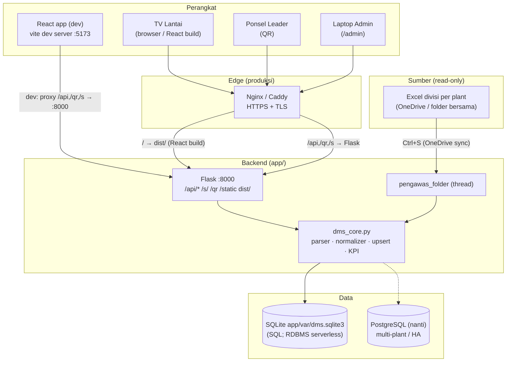

# DMS — Backend Plan

> **Rencana backend DMS** — dari prototipe Flask sekarang sampai produksi, dengan frontend React/Vite (branch `front-end`).
>
> Versi: **v1** · 24 November 2026 · Untuk: backend developer (kamu).
> Kontrak API yang dipegang frontend: **`docs/API_CONTRACT.md`** (v1).
> Aturan bisnis: `docs/laporan/DMS_Aturan_Sistem_v1.md` (v1.1 — nama manusiawi, tanpa kode).

---

## Daftar Isi

1. [Tujuan & konteks](#1-tujuan--konteks)
2. [Kondisi saat ini](#2-kondisi-saat-ini)
3. [Keputusan teknis (yang sudah dipilih)](#3-keputusan-teknis-yang-sudah-dipilih)
4. [Arsitektur target](#4-arsitektur-target)
5. [Integrasi dengan frontend (Vite + React)](#5-integrasi-dengan-frontend-vite--react)
6. [Skema data & "menggunakan SQL"](#6-skema-data--menggunakan-sql)
7. [Roadmap tahap A → D](#7-roadmap-tahap-a--d)
8. [Deployment & lingkungan](#8-deployment--lingkungan)
9. [Keamanan & auth](#9-keamanan--auth)
10. [Testing](#10-testing)
11. [Struktur repo & cara kerja tim](#11-struktur-repo--cara-kerja-tim)
12. [Milestone & definition of done](#12-milestone--definition-of-done)
13. [Risiko & mitigasi](#13-risiko--mitigasi)
14. [Pertanyaan terbuka](#14-pertanyaan-terbuka)

---

## 1. Tujuan & konteks

DMS (Daily Monitoring System) adalah papan monitoring harian per line per shift untuk 3 plant
(Snack, EP, NP, Dairy) × 5 divisi (SHE, Quality, Produksi, Delivery, Teknik). Frontend dikerjakan teman
(branch `front-end`, Vite + React 19 + ESLint). Backend dikerjakan kamu.

**Alur inti yang harus dilayani backend (tidak boleh berubah bentuk):**

```
Excel divisi (petugas isi seperti biasa, Ctrl+S)
   → pengawas folder (3 dtk) → ingest & normalisasi → upsert idempoten → SQLite
   → GET /api/state → TV / React (rotasi per divisi, gerbang absensi Absensi Dulu)
Ponsel (QR) → POST /api/konfirmasi → sesi DIKONFIRMASI → rotasi divisi terbuka
Panel admin (/admin) → status sync, karantina, jejak audit
```

Prinsip yang mengikat (lihat juga `docs/ALUR_APLIKASI_DMS.md`):

- **Sinkron Excel Otomatis** — satu arah: aplikasi **membaca** Excel, tidak pernah menulis.
- **Nol Langkah Tambahan** — nol langkah tambahan bagi petugas (tidak ada upload).
- **Satu papan, satu catatan** — satu papan, satu catatan; semua tampilan membaca sumber yang sama.
- **Absensi Dulu** — absensi dikerjakan lebih dulu (gerbang), Supervisor/DH boleh buka ulang dengan alasan.

---

## 2. Kondisi saat ini

Prototipe berjalan di `app/`:

| Komponen | File | Status |
|---|---|---|
| API + server | `app/server.py` (386 baris) | ✅ Jalan, 12 route |
| Inti data (parser, ingest, KPI) | `app/dms_core.py` (539 baris) | ✅ Jalan, teruji manual |
| Basis data | SQLite di `app/var/dms.sqlite3` | ✅ Berisi 15.940 kasus nyata (dari `reference/`) |
| Skema | DDL di `dms_core.SCHEMA` (SQL) | ✅ 7 tabel, 2 indeks |
| Seed | `app/seed_demo.py` | ✅ 9 sumber ter-ingest, sesi + 28 nama demo |
| Pengawas folder | Thread di `server.py` | ✅ Poll 3 dtk, debounce 4 dtk, lewati `~$*.xlsx` |
| Frontend | `front-end` branch (scaffold Vite) | ⏳ Belum ada integrasi |
| Auth | — | ❌ Belum ada |
| Tests | — | ❌ Belum ada |
| Deployment | — | ❌ Belum ada (dev lokal) |

**Yang sudah membuktikan nilai:** ingest workbook asli (15.940 kasus), baca sheet tahan header bergeser,
upsert idempoten (0 tambah / 0 ubah saat baca ulang), TV menyegar otomatis, gerbang absensi jalan.

---

## 3. Keputusan teknis (yang sudah dipilih)

| # | Keputusan | Alasan |
|---|---|---|
| 1 | **Backend tetap Python** (bukan rewrite ke Node) | Mesin Excel→DB (`dms_core.py`) sudah jadi & terverifikasi; menulis ulang paling mahal & rawan beda hasil |
| 2 | **Flask dipertahankan** untuk tahap A–B; FastAPI **opsional** di tahap C (lihat §7.4) | Flask sudah jalan; FastAPI dipilih bila butuh docs API otomatis & validasi pydantic tanpa ubah logika inti |
| 3 | **"Menggunakan SQL" = SQLite dulu** (dipilih) — dan memang sudah SQL | `dms_core.SCHEMA` sudah DDL SQL; SQLite adalah RDBMS serverless; cocok untuk pilot 1 server/plant. Jalur upgrade ke PostgreSQL ditulis di §6.4 — bukan diganti sekarang |
| 4 | **Frontend tidak di-stack di dalam Flask secara permanen** — Flask menyajikan `dist/` hasil `vite build` *atau* di belakang reverse proxy | Satu origin untuk TV/QR; tanpa CORS di produksi |
| 5 | **Kontrak API v1 dibekukan** (`docs/API_CONTRACT.md`) | Frontend bisa jalan paralel; perubahan bentuk = v2 |
| 6 | **Auth = Entra ID (akun M365)** untuk endpoint tulis | Sesuai keputusan platform (`DMS_Keputusan_Platform_dan_Akses_Online_v1.md`); tanpa lisensi per pengguna |
| 7 | **Excel tidak dibekukan & tetap baca-saja** | Sinkron Excel Otomatis, Kepemilikan Kolom |

---

## 4. Arsitektur target



**Mode pengembangan:** Vite dev server (`:5173`) proxy `/api`, `/qr`, `/s` → Flask `:8000`.
**Mode produksi:** `vite build` → `dist/`; Flask menyajikan `dist/` sebagai static **atau** Nginx di depan (lihat §8).

---

## 5. Integrasi dengan frontend (Vite + React)

### 5.1 Dev — proxy di `vite.config.js` (branch `front-end`)

```js
import react from '@vitejs/plugin-react'
import { defineConfig } from 'vite'

export default defineConfig({
  plugins: [react()],
  server: {
    proxy: {
      '/api': 'http://localhost:8000',
      '/qr':  'http://localhost:8000',
      '/s':   'http://localhost:8000',
    },
  },
})
```

Dengan proxy ini: **tidak perlu CORS** saat dev, dan `fetch('/api/state')` langsung jalan.

### 5.2 Produksi — dua opsi

| Opsi | Cara | Kelebihan | Kekurangan |
|---|---|---|---|
| **P1 · Flask sajikan dist/** | `npm run build` → `dist/`; Flask route `/` & static dari `dist/` | Satu origin, paling sederhana, tanpa CORS | Flask ikut melayani static (cukup untuk skala ini) |
| **P2 · Nginx di depan** | Nginx: `location / { root dist/; } location /api { proxy_pass :8000; }` | Lebih standar, TLS & cache static efisien | Komponen tambahan |

Rekomendasi: **P1 dulu**, P2 saat trafik/HA butuh.

### 5.3 Apa yang frontend panggil (ringkas)

| Kebutuhan | Endpoint | Polling |
|---|---|---|
| State landing TV & pilar (A-01, semua TV) | `GET /api/state?plant=&line=&demo=&tanggal=` | 15 dtk |
| State Dashboard ringkasan (A-02, PDCA/TL) | `GET /api/state?plant=…` — PDCA kirim semua plant; TL terkunci plant sendiri | 15 dtk |
| Ketuk absensi | `POST /api/absensi` | per aksi |
| Konfirmasi kehadiran | `POST /api/konfirmasi` | per aksi |
| Panel admin | `GET /api/admin` + `POST /api/sync` | 10 dtk |
| Gambar QR | `GET /qr/<token>.png` | on demand |
| Landing sesi | `GET /s/<token>` (atau dirender dari state) | on demand |

Detail lengkap: `docs/API_CONTRACT.md`.

### 5.4 Aturan kerja tim

- Frontend **jangan** membuat endpoint baru sebelum disepakati — tambahkan ke kontrak dulu.
- Nama field **tidak boleh diubah** tanpa menaikkan versi kontrak.
- Kode warna (`st` 0–3, hex divisi) **jangan** di-hardcode ulang di frontend bila sudah dikirim server — tapi boleh dipakai sebagai fallback.

---

## 6. Skema data & "menggunakan SQL"

### 6.1 Yang dimaksud "menggunakan SQL" di proyek ini

Aplikasi **sudah menggunakan SQL** (DDL + query) sejak awal — bukan menyimpan data sebagai JSON/CSV.
Yang dipakai sekarang adalah **SQLite** (RDBMS serverless, file `app/var/dms.sqlite3`):

```sql
CREATE TABLE IF NOT EXISTS sumber (
  sumber_id TEXT PRIMARY KEY, plant TEXT, line TEXT, divisi TEXT,
  path TEXT, sheet TEXT, status TEXT DEFAULT 'aktif', ... );
CREATE TABLE IF NOT EXISTS kasus (
  kunci_baris TEXT PRIMARY KEY, sumber_id TEXT, plant TEXT, line TEXT, divisi TEXT,
  tanggal TEXT, shift TEXT, lbn TEXT, masalah TEXT, ... );
-- + karantina, ingest_log, sesi, absensi, audit (lihat dms_core.SCHEMA)
```

Kelebihan untuk fase ini: tanpa server DB, mudah di-backup (salin 1 file), query SQL standar, cukup untuk 1 plant / pilot.

### 6.2 Tabel (7) & aturan kunci

| Tabel | PK | Isi |
|---|---|---|
| `sumber` | `sumber_id` | Registry berkas divisi (plant×divisi) |
| `kasus` | `kunci_baris` (hash) | Log kasus; idempoten; `terhapus` = hilang dari sumber |
| `karantina` | `id` | Baris Excel tidak terbaca |
| `ingest_log` | `id` | Riwayat ingest |
| `sesi` | `sesi_id` | Sesi DMS (DIBUKA/DIKONFIRMASI) + token QR |
| `absensi` | `(sesi_id, nama)` | Status per nama per sesi |
| `audit` | `id` | Jejak aksi (pelaku, aksi, rinci JSON) |

### 6.3 Prinsip integritas

- **Idempoten:** `kunci_baris = sha(plant, divisi, tanggal, shift, line, lbn, masalah)`; baca ulang file = 0 dobel.
- **Retensi:** baris hilang dari Excel → `terhapus=1`, tidak pernah `DELETE` (≥ 5 tahun).
- **Karantina bukan sampah:** selalu tersimpan dengan alasan + cuplikan; terlihat di `/admin`.
- **Audit selalu ditulis** untuk aksi manusia (absensi, konfirmasi, buka ulang, sync manual).

### 6.4 Jalur upgrade SQLite → PostgreSQL (kapan & caranya)

**Kapan pindah:** saat (a) lebih dari 1 plant aktif bersamaan, (b) TV/admin diakses banyak orang bersamaan dengan tulis berat, atau (c) perlu backup/replikasi standar.

**Cara (tanpa ubah logika bisnis):**

| Aspek | SQLite sekarang | PostgreSQL nanti |
|---|---|---|
| Driver | `sqlite3` (stdlib) | `psycopg` v3 |
| Placeholder | `?` | `%s` |
| DDL | `AUTOINCREMENT`, `TEXT` | `GENERATED … AS IDENTITY`, `TEXT`/`VARCHAR` |
| Migrasi skema | `executescript(SCHEMA)` | file migrasi (mis. `migrations/0001_init.sql`) atau Alembic |
| Koneksi | langsung file | connection pool (`psycopg_pool`) |
| Backup | `cp dms.sqlite3 backup/` | `pg_dump` terjadwal |

**Strategi:** ekstrak semua SQL ke satu modul `db.py` dengan interface kecil (`connect()`, `query()`, `execute()`), lalu ubah implementasi di belakangnya. Karena query sudah SQL standar, perubahannya lokal — `dms_core.py` tidak perlu disentuh selain import.

**Jangan lakukan sekarang** kecuali (a)/(b)/(c) terpenuhi — mengganti DB sebelum kebutuhan = pekerjaan tanpa hasil.

### 6.5 Lokasi & backup

- Dev/pilot: `app/var/dms.sqlite3` — **tidak ikut Git** (`.gitignore`).
- Backup harian (pilot): salin file saat server idle, simpan 14 hari.
- Produksi nanti: `pg_dump` harian + uji restore per kuartal.

---

## 7. Roadmap tahap A → D

### 7.1 Tahap A — Fondasi & integrasi frontend (± 2–3 hari)

| # | Tugas | Selesai bila |
|---|---|---|
| A1 | Tambah route Flask untuk menyajikan `dist/` (opsi P1) | `npm run build` → buka `http://localhost:8000/` = React app |
| A2 | (Alternatif P2) tulis `deploy/nginx.conf` contoh | `location /api → :8000`, `location / → dist/` |
| A3 | Rapikan `app/requirements.txt` versi terkunci + `.env.example` (PORT, paths) | Instal bersih di mesin baru |
| A4 | Pisahkan mode demo: `seed_demo.py --demo` vs `--production` | Produksi tidak mengisi 28 nama demo diam-diam |
| A5 | Dokumentasikan cara run di `app/README.md` (sudah ada, sesuaikan) | Teman frontend bisa run sendiri |

### 7.2 Tahap B — Kualitas API & kontrak (± 3–5 hari)

| # | Tugas | Selesai bila |
|---|---|---|
| B1 | Tulis/tepati `docs/API_CONTRACT.md` (sudah dibuat) | Ditanda tangani tim |
| B2 | Validasi input semua `POST`: `status` ∈ enum; `nama` wajib & harus ada (400 bila tidak) | Tes gagal bila nama salah |
| B3 | Error handler global → JSON `{ok:false, pesan}` (bukan HTML 500) | 500 pun tetap JSON |
| B4 | `pytest` unit: parser header bergeser, upsert idempoten, `norm_*`, `kpi_periode`, `ingest_file` | Hijau di CI lokal |
| B5 | Contract test: respons `/api/state` & `/api/admin` sesuai skema kontrak (jsonschema) | Hijau |
| B6 | Idempotency `POST /api/konfirmasi` (skip bila sudah DIKONFIRMASI) + audit | Audit tidak dobel |
| B7 | `POST /api/sync`: bila semua sumber gagal → HTTP 500/207 dengan detail; bila sebagian → 200 + `ok:false` per item (dokumentasikan) | Frontend tidak salah tafsir |

### 7.3 Tahap C — Auth & keamanan (± 3–5 hari, sebelum akses lintas jaringan)

| # | Tugas | Selesai bila |
|---|---|---|
| C1 | Login frontend MSAL (Entra ID) pada `/admin` & aksi tulis | Token didapat |
| C1b | **Akses Dashboard ringkasan (A-02):** grup Entra `DMS-PDCA-*` → **PDCA** (semua plant), grup `DMS-TL-*` + klaim plant → **TL** (plant sendiri). Frontend `/dashboard` dibungkus `RequireRole`; TV (`role=tv`) tidak boleh melihat/menautkan ke Dashboard. Endpoint agregat lintas plant → **403** untuk TL (Batas Data per Plant) | TV tanpa Dashboard; PDCA lihat semua plant; TL terkunci plant sendiri |
| C2 | Backend verifikasi JWT (PyJWT + JWKS tenant; `audience` = client id app) | 401 bila token invalid/expired |
| C3 | Proteksi peran: `/api/buka`, `/api/sync`, `/admin` → Supervisor/DH/Admin; `/api/absensi`, `/api/konfirmasi` → terautentikasi | 403 sesuai peran |
| C4 | QR sesi: token kedaluwarsa per shift + endpoint cabut token (`POST /api/sesi/cabut`, Admin) | Token lama ditolak (404/410) |
| C5 | Rate limit `POST /api/*` (mis. Flask-Limiter) | Brute force ditolak 429 |
| C6 | Semua `pelaku` di audit diambil dari token, bukan dari body | Audit jujur |

### 7.4 Tahap D — Produksi & pemeliharaan (± 5–10 hari, bertahap)

| # | Tugas | Selesai bila |
|---|---|---|
| D1 | `Dockerfile` + `docker-compose.yml` (app + [postgres opsional]) | `docker compose up` jalan |
| D2 | Atau systemd service + `gunicorn`/`waitress` (Windows: waitress) | Restart otomatis |
| D3 | HTTPS via reverse proxy (Caddy/Nginx + Let's Encrypt) | `https://` valid |
| D4 | Logging terstruktur (`logging` → file + rotasi) | Error terlacak |
| D5 | Backup terjadwal (`dms.sqlite3` / `pg_dump`) + uji restore | Restore < 30 menit |
| D6 | (Opsional) `db.py` abstraction → PostgreSQL bila dipicu §6.4 | Migrasi < 1 hari |
| D7 | Notifikasi Teams/email via Power Automate (konektor standard): karantina baru, lewat tenggat | PIC dapat kabar |
| D8 | Monitoring `/healthz` (uptime check eksternal) | Alert bila mati |
| D9 | SSO role mapping dari Entra ID groups → peran DMS (termasuk **PDCA** = semua plant & **TL** = plant sendiri, A-02) | Tidak perlu set manual |
| D10 | Runbook insiden (TV mati, Excel corrupt, DB corrupt, token bocor) | Ada dokumen & diuji |

**FastAPI (opsional, di akhir C atau awal D):** angkat route Flask → FastAPI bertahap (`/api/state` paling akhir). `dms_core.py` dipakai apa adanya; validasi otomatis dari kontrak; dokumentasi di `/docs` untuk frontend. **Bukan keharusan** — Flask yang dirapikan (B+C) sudah cukup lama.

---

## 8. Deployment & lingkungan

### 8.1 Lingkungan

| Environment | Tujuan | URL (contoh) | DB |
|---|---|---|---|
| `dev` | Laptop kamu & teman | `localhost:8000` / `:5173` (proxy) | SQLite file lokal |
| `pilot` | 1 plant (Snack Line 9) | `http://<server>:8000` (LAN) | SQLite + backup |
| `prod` | Semua plant | `https://dms.<domain-perusahaan>` | PostgreSQL (atau SQLite terjadwal backup bila tetap kecil) |

### 8.2 Konfigurasi via environment (`.env`)

```
PORT=8000
DMS_DB_PATH=app/var/dms.sqlite3      # atau postgresql://… saat §6.4
DMS_DEMO=0                           # 1 = mode demo (pita kuning), 0 = data hari ini
DMS_PLANT=Snack
ENTRA_TENANT_ID=…                    # tahap C
ENTRA_CLIENT_ID=…                    # tahap C
DMS_SESSION_TTL_MINUTES=600          # tahap C (kedaluwarsa token QR/sesi)
```

### 8.3 Langkah deploy pilot (Windows server, tanpa cloud)

```powershell
git clone … ; cd DailyMonitoringSystem_App
pip install -r app\requirements.txt
python app\seed_demo.py --production   # bukan seed demo
python -m waitress --listen=0.0.0.0:8000 app.server:app
# atau Docker: docker compose up -d
```

Firewall: buka port 8000 (atau 443 via reverse proxy). TV diarahkan ke `http://<server>:8000/?plant=Snack&line=Line%209`.

---

## 9. Keamanan & auth

| Area | Sekarang | Target |
|---|---|---|
| Identitas | Tidak ada (semua terbuka) | Entra ID JWT; peran dari group mapping |
| TV / landing | Terbuka (baca + ketuk absensi) | Tetap terbuka untuk baca (A-01); absensi butuh auth tahap C (atau batasi IP TV + signage) |
| Dashboard ringkasan (`/dashboard` React) | Terbuka (v1) — hanya dijaga UI/operasi (A-02) | SSO + grup `DMS-PDCA-*` (semua plant) / `DMS-TL-*` + klaim plant (A-02); TL lintas plant → 403 (Batas Data per Plant) |
| Penulisan | Terbuka | SSO wajib; Supervisor/DH/Admin untuk buka ulang & sync |
| QR token | Statik per sesi, tidak kedaluwarsa | Per shift + TTL + cabut (QR Satu Pintu) |
| Input | Belum divalidasi | Validasi + 400/401/403 |
| Secrets | Tidak ada di repo | `.env` tidak di-commit; `app/var/` di `.gitignore` |
| Data Excel | Read-only oleh app | Tetap (Sinkron Excel Otomatis/Kepemilikan Kolom) |
| Audit | `audit` table | Pelaku dari token; retensi ≥ 5 tahun |

Catatan: jangan taruh kredensial/secret di repo, chat, atau dokumen — gunakan `.env`/variabel lingkungan server.

---

## 10. Testing

| Level | Apa | Tool | Kapan |
|---|---|---|---|
| Unit | `norm_*`, `parse_date`, `find_header`, `upsert` idempoten, `kpi_periode`, `norm_status` | pytest | Setiap perubahan `dms_core.py` |
| Contract | Skema JSON `/api/state`, `/api/admin`, error 409/404 sesuai kontrak | pytest + `jsonschema` | Setiap perubahan route |
| Integrasi | `seed_demo.py` di salinan DB sementara; POST absensi → konfirmasi → buka ulang → konfirmasi | pytest | Tahap B |
| Manual | TV di browser (1600×900), ponsel QR, `/admin` sync | checklist | Rilis |
| Data nyata | Ingest `reference/` = harus **0 tambah / 0 ubah** saat baca ulang | pytest (fixture) | CI opsional |

Fixtures: salinan kecil `reference/*.xlsx` ke `tests/fixtures/` **hanya bila ukurannya wajar**; jika tidak, generate workbook uji di test (openpyxl) dengan header bergeser & tanggal 5 format — lebih cepat & tidak memperbesar repo.

---

## 11. Struktur repo & cara kerja tim

```
DailyMonitoringSystem_App/
├── app/                      ← BACKEND (kamu)
│   ├── server.py             route Flask (12 route)
│   ├── dms_core.py           inti: skema SQL, parser, ingest, KPI
│   ├── seed_demo.py          seed awal (--demo / --production)
│   ├── registry.json         daftar sumber Excel
│   ├── setup_onedrive.ps1    pasang OneDrive+junction (IT)
│   ├── requirements.txt
│   └── var/                  SQLite (TIDAK di Git)
├── frontend/ atau branch `front-end`/   ← FRONTEND (teman)
├── docs/
│   ├── ALUR_APLIKASI_DMS.md  peta alur (front & back)
│   ├── API_CONTRACT.md       kontrak v1 (pegangan bersama)
│   ├── BACKEND_PLAN.md       dokumen ini
│   └── laporan/              aturan sistem (lihat `docs/laporan/DMS_Aturan_Sistem_v1.md` v1.1) & keputusan platform
├── reference/                workbook acuan (read-only)
└── tests/                    (baru) pytest
```

**Alur kerja:**

1. Backend ubah → perbarui `API_CONTRACT.md` di PR yang sama.
2. Frontend tarik perubahan docs + `git pull`; kontrak adalah single source of truth.
3. Branch kerja: `arena/ca138dd1-…` (backend/docs) dan `front-end` (React). Jangan campur commit frontend ke branch backend.
4. Release note singkat per milestone di `docs/CHANGELOG.md` (baru).

---

## 12. Milestone & definition of done

| Milestone | Isi | DoD |
|---|---|---|
| **M0** | Kontrak v1 disepakati (dokumen ini + API_CONTRACT) | Kedua pihak setuju, tidak ada endpoint "mengambang" |
| **M1** | React bisa baca `/api/state` & tampilkan halaman absensi + 1 halaman divisi | Demo: React TV menampilkan data asli dari Flask |
| **M2** | Paritas fitur React = TV HTML (7 halaman, rotasi, gerbang Absensi Dulu, QR) | TV HTML bisa digantikan build React |
| **M3** | Auth Entra ID (tahap C minimal C1–C3, termasuk **C1b A-02**) | Tulis tanpa token = 401; peran Supervisor/Admin berlaku; **Dashboard hanya PDCA/TL** (TV tanpa Dashboard) |
| **M4** | Pilot Snack Line 9 (tahap A+B penuh, backup, runbook) | 1 minggu operasi tanpa insiden data |
| **M5** | Produksi 3 plant + Delivery/Teknik onboard | 15.940+ kasus, semua divisi `tersinkron` |
| **M6** | (Opsional) PostgreSQL & HA | Migrasi sesuai §6.4 |

---

## 13. Risiko & mitigasi

| Risiko | Dampak | Mitigasi |
|---|---|---|
| Excel divisi diedit dengan format berbeda (kolom pindah, sheet diganti nama) | Ingest gagal / karantina membengkak | Parser sudah tahan geser; tambahkan alert ke `/admin` + runbook "kolom Excel berubah" |
| Petugas menyimpan file saat TV membaca | Baca file setengah jadi | Debounce 4 dtk + lewati `~$*.xlsx`; tetap ada risiko kecil → baca via snapshot salin dulu (perbaikan opsional) |
| SQLite lock saat tulis bersamaan | 500 sesaat | `timeout=20` sudah; tulis sangat ringan; pindah Postgres bila sering |
| Token QR bocor (foto di grup WA) | Absensi/konfirmasi palsu di shift itu | TTL per shift + cabut token + audit (tahap C) |
| Frontend ubah ekspektasi field diam-diam | TV rusak | Kontrak di PR; contract test (B5) |
| Workbook Delivery/Teknik belum diserahkan | 2 halaman TV kosong | Status `menunggu_berkas` jujur; tidak menghalangi MV P |
| Laptop petugas offline | TV basi | Status Berkas Jujur: status "belum tersinkron" terlihat; bukan data palsu |

---

## 14. Pertanyaan terbuka

1. Apakah pilot tetap **satu server di plant** (LAN) atau langsung online lintas jaringan (butuh tahap C lebih dulu)?
2. Siapa yang mengoperasikan server (IT plant / kantor pusat), dan di mana backup disimpan?
3. Apakah Delivery & Teknik sudah punya workbook final untuk didaftarkan (format & sheet name)?
4. Apakah daftar nama absensi produksi akan diimpor dari Excel kepegawaian (formatnya seperti apa)?
5. Perlu PWA (install ke TV/HP) atau website biasa sudah cukup?
6. Access ke Entra ID: siapa admin tenant yang membuat app registration?

Jawaban atas #1 menentukan urutan tahap C vs D — konfirmasi ke tim sebelum tahap C dimulai.

---

*Dokumen ini v1 (24 Nov 2026). Perbarui saat keputusan di §3/§6.4/§12 berubah.*
