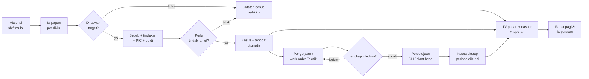
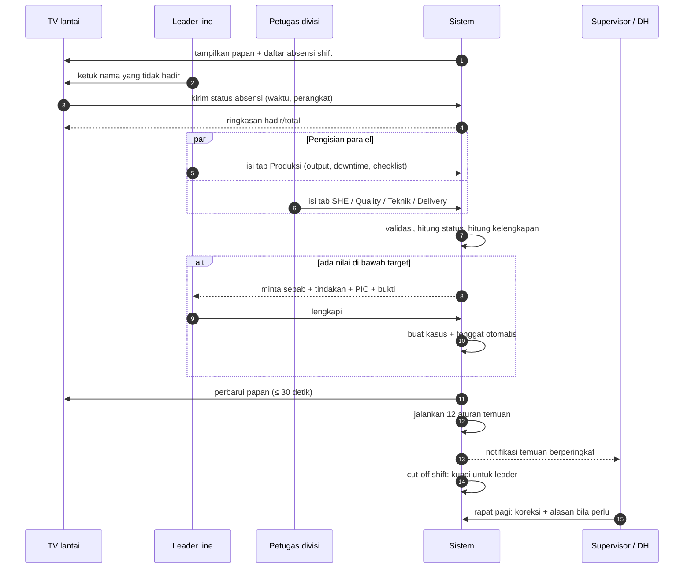
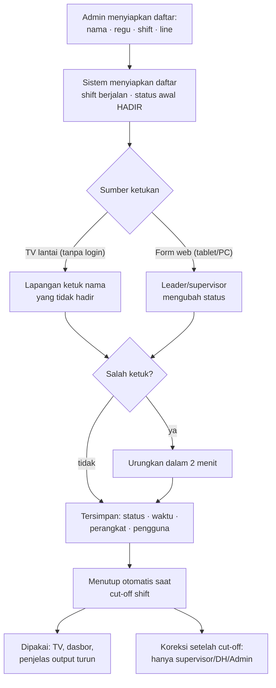
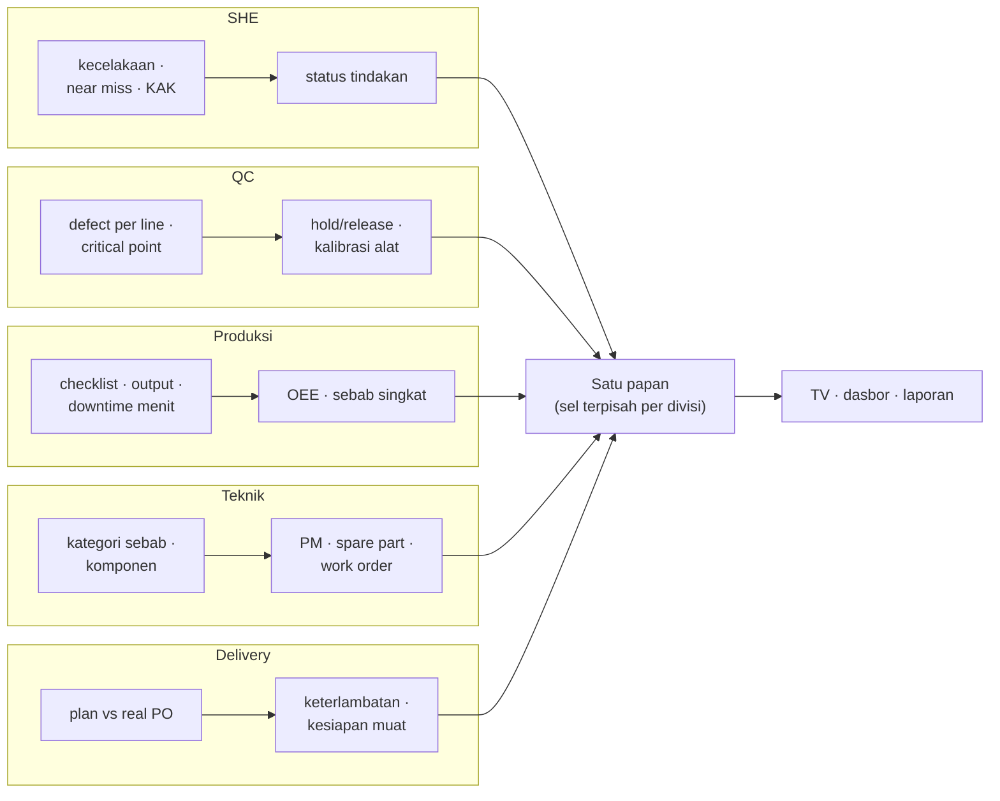
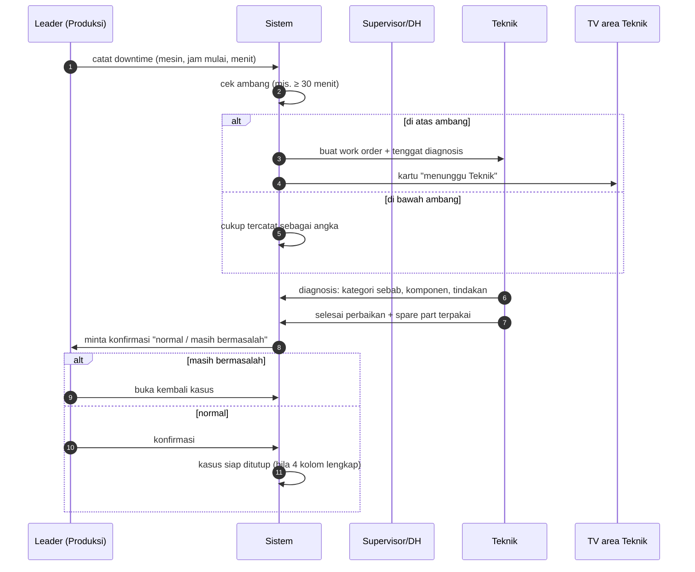
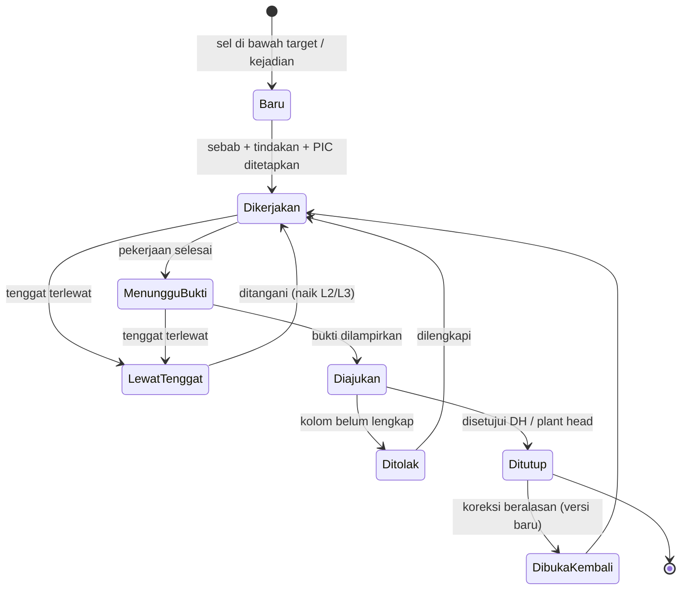
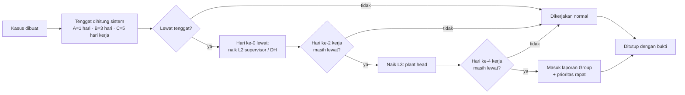
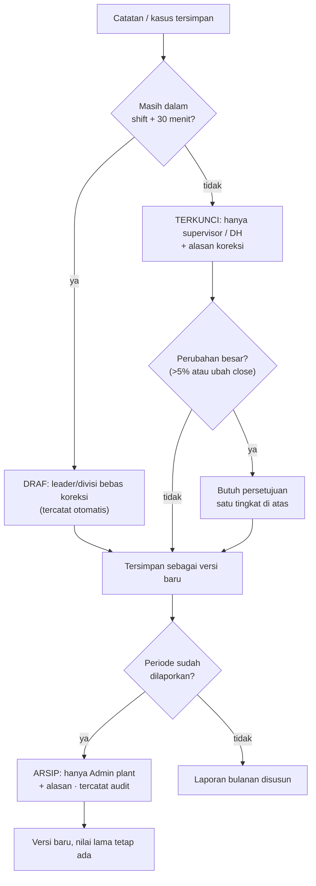
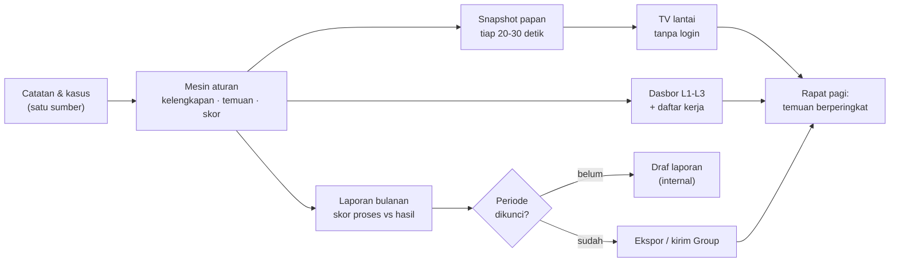
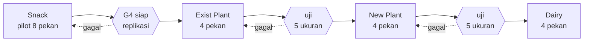

# 03 · Alur Sistem DMS Digital

**Dokumen:** bagian 3 dari 3 rancangan aplikasi Daily Monitoring System (DMS)
**Status:** rancangan untuk sosialisasi & uji terima
**Tanggal:** 5 November 2026

> Urutan baca: [`01-KENAPA-DMS-DIGITAL.md`](01-KENAPA-DMS-DIGITAL.md) → [`02-RANCANGAN-APLIKASI.md`](02-RANCANGAN-APLIKASI.md) → **file ini (alur)**.
> Setiap langkah di bawah mengacu pada aturan bernomor di [`DMS_Aturan_Sistem_v1.md`](../DMS_Aturan_Sistem_v1.md).

---

## 0. Peta besar alur

Sembilan alur yang dirinci:

1. Alur harian per shift (paling sering dipakai)
2. Alur absensi
3. Alur isian papan per divisi
4. Alur serah terima downtime ke Teknik
5. Alur kasus sampai ditutup (state machine)
6. Alur tenggat & eskalasi
7. Alur koreksi & kunci periode
8. Alur TV dan laporan
9. Alur replikasi plant

---

## 1. Alur harian per shift (swimlane)

| Waktu | Siapa | Langkah | Keluaran |
|---|---|---|---|
| 06.00–06.30 | Sistem | siapkan papan + daftar absensi shift | papan kosong bertanda "belum diisi" |
| 06.30–07.00 | Leader | konfirmasi absensi (hanya yang tidak hadir) | kehadiran shift |
| 06.30–07.30 | Leader & divisi | isi bagian masing-masing | sel papan terisi |
| 07.30 | Sistem | validasi & buat kasus bila di bawah target | kasus + tenggat |
| 07.30 | Sistem | perbarui TV & dasbor | papan terkini |
| 08.30 | Supervisor/DH | rapat pagi memakai temuan berperingkat | keputusan & penugasan |
| akhir shift + 30 mnt | Sistem | cut-off untuk leader | catatan terkunci |

> Papan **boleh terisi sebagian**. Pilar yang belum diisi ditandai "belum diisi" + jam terakhir dicek,
> bukan dikosongkan (R-12, R-14).

---

## 2. Alur absensi

Aturan kunci:

| Aturan | Isi |
|---|---|
| R-31 | daftar nama disiapkan Admin (impor Excel dianjurkan) |
| R-32 | status awal **hadir**; lapangan hanya menandai yang tidak hadir |
| R-33 | TV dan form menulis ke catatan absensi yang sama |
| R-34 | TV hanya bisa absen untuk shift berjalan & line miliknya |
| R-35 | setiap ketukan tercatat; urungkan 2 menit |
| R-37 | absensi jadi penjelas otomatis bila output di bawah target |
| R-38 | absensi **tidak** dipakai menilai orang di dalam sistem |

Status yang tersedia: `hadir` · `sakit` · `izin` · `alpa` · `terlambat` · `dinas luar`.

---

## 3. Alur isian papan per divisi

| Langkah | Siapa | Yang dikerjakan | Batas |
|---|---|---|---|
| 1 | Leader | buka papan line-nya, pilih shift | awal shift |
| 2 | Petugas divisi | isi tab divisi sendiri (target menempel pada item) | sebelum cut-off |
| 3 | Sistem | validasi: hasil wajib, sebab wajib bila di bawah target | saat simpan |
| 4 | Leader | isi tab Produksi; tab lain hanya bila ditandai "boleh diisi leader" | sebelum cut-off |
| 5 | Sistem | tandai pilar "belum diisi" + jam cek terakhir | berjalan |
| 6 | Divisi | kirim bagian sendiri (tombol kirim per divisi) | kapan saja |

Divisi **tidak bisa** menimpa sel divisi lain (R-08) — inilah yang mencegah angka pilar ditimpa.

---

## 4. Alur serah terima downtime ke Teknik

Ini alur yang paling sering menimbulkan kerja ganda; karena itu dipecah dua pemilik.

| Langkah | Pemilik | Isi | Batas waktu |
|---|---|---|---|
| 1 | Produksi | mesin, jam mulai–selesai, menit berhenti, output hilang | saat kejadian |
| 2 | Sistem | bandingkan ambang → buat work order | ≤ 1 menit |
| 3 | Teknik | kategori sebab (mekanik/elektrik/utilitas/setting/operator), komponen, tindakan, WO, spare part, teknisi | **≤ 4 jam** (dampak A) / ≤ 24 jam (B) |
| 4 | Teknik | serah terima: mesin jalan / uji coba | setelah perbaikan |
| 5 | Produksi | konfirmasi normal atau kasus dibuka lagi | 1 shift berikutnya |

Kategori sebab **dikunci lima pilihan** supaya antar plant bisa dibandingkan (R-16).

---

## 5. Alur kasus sampai ditutup (state machine)

Gerbang penutupan (R-45):

| Kolom | Isi minimal | Bila kosong |
|---|---|---|
| Sebab | penyebab sebenarnya (bukan "operator") | tombol ajukan nonaktif |
| Tindakan | perbaikan + pencegahan bila berulang | tombol ajukan nonaktif |
| Bukti | ≥ 1 foto/dokumen | tombol ajukan nonaktif |
| PIC | nama pemilik kasus | tombol ajukan nonaktif |

Tambahan: **persetujuan** harus dari peran berbeda dengan pengaju (R-09), dan kasus berulang ≥3×/90 hari
wajib memuat **PICA + tindakan pencegahan** (R-48).

---

## 6. Alur tenggat & eskalasi

| Aturan | Isi |
|---|---|
| R-46 | tenggat dihitung dari dampak, bukan diketik |
| R-47 | lewat tenggat → L2 hari ke-0 · L3 hari ke-2 · laporan Group hari ke-4 (hari kerja) |
| R-50 | tanpa aktivitas 14 hari → ditandai "dingin", ditanyakan di rapat (bukan ditutup) |

Kartu di TV selalu menampilkan **umur kasus** dan **tingkat eskalasi** supaya tidak menunggu rapat.

---

## 7. Alur koreksi & kunci periode

| Status | Siapa boleh ubah | Syarat |
|---|---|---|
| **Draf** | leader / petugas divisi pemilik | otomatis tercatat |
| **Terkunci** | supervisor, DH, kepala divisi | wajib alasan; nilai lama disimpan |
| **Arsip** | admin plant | koreksi = versi baru, bukan menimpa |

Tidak ada fitur hapus untuk peran mana pun — hanya **batal** dan **arsip** (R-44).

---

## 8. Alur TV dan laporan

TV tahan gangguan:

| Keadaan | Perilaku TV |
|---|---|
| Data hari ini belum ada | tampilkan angka kemarin + tanda **"data kemarin"** |
| Jaringan putus | tampilkan snapshot terakhir + jam pembaruan |
| Pilar belum diisi | sel abu-abu "belum diisi", bukan kosong |
| Jaringan pulih | ambil snapshot baru, tanpa perlu restart |
| Absensi | tetap bisa diketuk (terkirim saat jaringan kembali); ketukan yang tiba setelah cut-off masuk sebagai usulan koreksi ke Supervisor, bukan menimpa langsung |

---

## 9. Alur replikasi plant

| Dibawa saat replikasi | Tetap lokal di plant |
|---|---|
| master line & mesin (pola) | target plant |
| template item & aturan insight | kalender libur |
| profil TV (pola tampilan) | daftar nama, regu, dan shift |
| struktur kasus & PICA | PIC dan jalur persetujuan |

Total: 8 + 4 + 4 + 4 = **20 pekan**.

---

## 10. Ringkasan SLA dan batas waktu

| Hal | Batas waktu | Siapa yang menjaga |
|---|---|---|
| Isi papan satu shift | selesai sebelum cut-off (shift + 30 menit) | leader & divisi |
| Konfirmasi absensi | sebelum shift berjalan berakhir | leader (via TV/form) |
| Perbaikan data setelah cut-off | sebelum rapat pagi berikutnya | supervisor / DH |
| Diagnosis downtime | 4 jam (dampak A) / 24 jam (dampak B) | Teknik |
| Penutupan kasus | sesuai tenggat dampak (1/3/5 hari kerja) | PIC + penyetuju |
| Kunci periode | setelah laporan bulanan disahkan | plant head / admin |
| Perbarui tampilan TV | ≤ 30 detik dari input | sistem |

---

## 11. Uji alur (dipakai saat uji terima)

| # | Skenario | Hasil yang diharapkan |
|---|---|---|
| 1 | Leader mengisi output di bawah target tanpa sebab | sistem menolak simpan, menyebut kolom sebab |
| 2 | Petugas SHE mencoba mengubah sel QC | ditolak, tercatat |
| 3 | Leader mengubah catatan 45 menit setelah shift | ditolak; harus supervisor + alasan |
| 4 | Kasus downtime 48 menit dicatat Produksi | work order Teknik otomatis muncul dengan tenggat |
| 5 | Kasus ditutup tanpa bukti | tombol nonaktif, pesan jelas |
| 6 | Kasus berulang ke-3 dalam 90 hari | wajib PICA sebelum boleh ditutup |
| 7 | Kasus lewat tenggat 2 hari kerja | sudah di L3 (plant head) sejak hari ke-2; L2 sejak hari ke-0; muncul di dasbor tingkatnya |
| 8 | TV dimatikan saat jaringan putus | tetap menampilkan papan terakhir + jam |
| 9 | Absensi diketuk di TV lalu dibuka di form | status sama, tidak ada duplikat |
| 10 | Laporan Oktober dibuka setelah dikunci | hanya Admin, dengan alasan, versi baru |

---

## 12. Ringkasan: siapa melakukan apa

| Peran | Alur yang dijalankan | Keluaran |
|---|---|---|
| Leader line | 1, 2, 3 | papan terisi, absensi, kasus baru |
| Petugas divisi | 3 | bagian pilar terisi |
| Teknik | 4, 5 | work order, diagnosis, PM |
| Supervisor / DH | 5, 6, 7 | persetujuan, koreksi, eskalasi |
| Plant head | 6, 7 | keputusan prioritas, kunci periode |
| Admin plant | 2, 7, 8 | daftar nama, target versi, profil TV, audit |
| Group | 8, 9 | perbandingan plant, gerbang replikasi |
| TV | 1, 2, 8 | tampilan papan + ketukan absensi |
