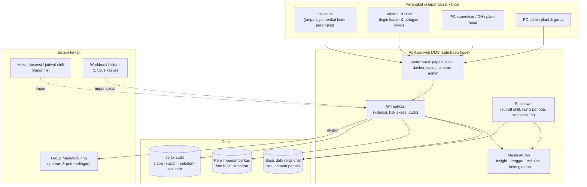
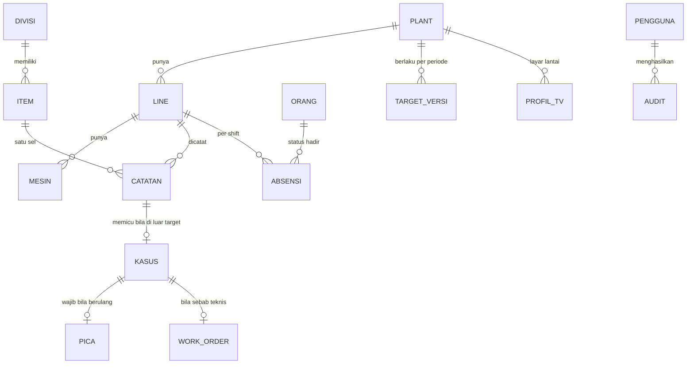
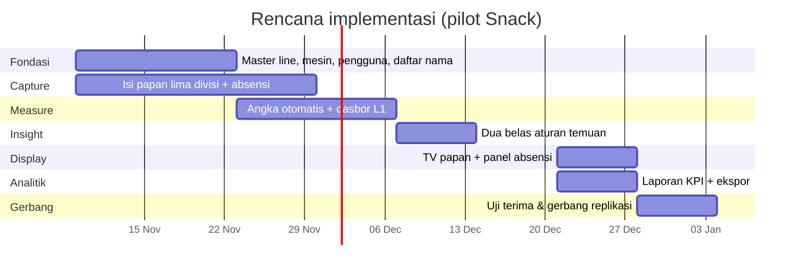

# 02 · Rancangan Aplikasi DMS Digital

**Dokumen:** bagian 2 dari 3 rancangan aplikasi Daily Monitoring System (DMS)
**Status:** rancangan untuk dibangun — belum ada implementasi kode
**Tanggal:** 5 November 2026

> Sebelum membaca ini: [`01-KENAPA-DMS-DIGITAL.md`](01-KENAPA-DMS-DIGITAL.md) (alasan & tujuan) →
> file ini (bentuk aplikasi) → [`03-ALUR-SISTEM.md`](03-ALUR-SISTEM.md) (alur kerja).
> Aturan baku: [`DMS_Aturan_Sistem_v1.md`](../DMS_Aturan_Sistem_v1.md).

---

## 0. Ringkasan

**Satu aplikasi web, tiga wajah, satu basis data.**

| Wajah | Alamat | Perangkat | Untuk | Hak |
|---|---|---|---|---|
| **Papan lantai** | `/tv/<kode-tv>` | TV area produksi | semua orang di area | lihat papan + ketuk absensi |
| **Isi papan** | `/isi/<plant>/<line>` | tablet / PC line | leader, petugas divisi | isi catatan, absensi, buka kasus |
| **Kantor** | `/app` | PC | supervisor, DH, plant head, admin | dasbor, kasus, laporan, aturan |

Bukan tiga aplikasi: satu basis kode, satu login sistem, satu sumber angka. Yang berbeda hanya
tata letak, hak, dan perangkat.

---

## 1. Arsitektur



Prinsip arsitektur:

1. **Baca dan tulis lewat satu API.** Tidak ada tabel ringkasan yang ditulis tangan.
2. **TV tidak menyimpan logika.** TV menerima tampilan siap-tampil (snapshot) + mengirim ketukan absensi.
3. **Semua aturan waktu di penjadwal**, bukan di kepala orang: cut-off shift, kunci periode, tenggat, eskalasi.
4. **Audit di lapisan API**, bukan di aplikasi klien, supaya tidak bisa dilewati.
5. **Berkas (foto/dokumen) dipisah dari basis data**, hanya metadatanya yang masuk DB.

---

## 2. Peta modul (tujuh layar + dua pendukung)

| # | Modul | Layar | Fungsi inti | Halaman deck |
|---|---|---|---|---|
| 1 | **Isi papan** | `/isi/...` | tab divisi, sel papan, sebab, bukti, absensi, kirim bagian | 5 |
| 2 | **Papan lantai** | `/tv/...` | tampilan papan penuh, rotasi pilar | 6 |
| 3 | **Absensi** | panel di TV & isian | konfirmasi hadir, urungkan, rekap shift | 7 |
| 4 | **Dasbor L1–L3** | `/app/dasbor` | kartu KPI, tren, temuan berperingkat, daftar kerja | 8 |
| 5 | **Detail kasus** | `/app/kasus/:kode` | riwayat, empat kolom wajib, PICA, lampiran, dampak | 9 |
| 6 | **Laporan & KPI** | `/app/laporan` | skor proses vs hasil, KPI V/O, ekspor | 10 |
| 7 | **Admin** | `/admin` | target per versi, profil TV, kunci periode, jejak audit | 11 |
| 8 | *Masuk & peran* | `/masuk` | login, sesi, ganti plant (bila berhak) | — |
| 9 | *Notifikasi* | lonceng | temuan baru, tenggat dekat, approval menunggu | — |

Navigasi kantor (sidebar): **Hari ini · Kasus terbuka · Tren pekan · Perbandingan plant · Laporan & KPI · Pengaturan**.

---

## 3. Model data

### 3.1 Entitas inti

| Entitas | Isi pokok | Kunci aturan |
|---|---|---|
| `plant` | kode (SN/EP/NP/DR), nama, zona waktu, kalender libur | R-02, R-05 |
| `bu_factory` | unit di plant (mis. Factory 10) | R-02 |
| `line` | kode (SN-L09), nama seragam, plant, BU | R-06 (satu ejaan) |
| `mesin` | kode, nama, line, jenis | dipakai Teknik |
| `divisi` | SHE, Quality, Produksi, Teknik, Delivery; urutan, warna, ikon | R-11 |
| `item` | nama, divisi, satuan, target, jenis isian, ritme, boleh-diisi-leader | R-13, R-24 |
| `catatan` | **satu baris per sel**: line + tanggal + shift + item + nilai + status | R-01, R-04 |
| `kasus` | kode, plant, line, mesin, divisi, dampak A/B/C, sebab, tindakan, PIC, bukti, tenggat, status | R-45–R-50 |
| `pica` | kasus, tahap why-1..why-5, temuan, tindakan pencegahan | R-48 |
| `work_order` | kasus, kategori sebab (5 pilihan), komponen, teknisi, mulai/selesai | R-15–R-18 |
| `absensi` | tanggal, shift, line, orang, status, waktu ketuk, perangkat | R-31–R-39 |
| `orang` | nama, NIK opsional, regu, divisi, line utama | R-31 |
| `pengguna` | akun, peran, plant, line yang boleh diakses | R-07–R-10 |
| `target_versi` | plant, periode berlaku, target & bobot per item | R-51–R-54 |
| `profil_tv` | kode perangkat, plant/line, pilar tampil, rotasi, mode | R-55–R-61 |
| `koreksi` | catatan/kasus, nilai lama, nilai baru, alasan, penyetuju | R-40–R-44 |
| `audit` | aktor, aksi, entitas, sebelum, sesudah, waktu, perangkat | R-53 |

### 3.2 Relasi



### 3.3 Bentuk `catatan` (inti sistem)

```
catatan
├─ id
├─ plant_id · line_id · divisi_id · item_id     (pemilik sel)
├─ tanggal · shift · ritme                      (kapan berlaku)
├─ nilai_angka | nilai_pilihan | nilai_biner    (salah satu sesuai jenis item)
├─ status  : SESUAI | DI_BAWAH | LEWAT | NIHIL | BELUM
├─ sebab_teks · tindakan_teks · pic_id
├─ kasus_id (opsional, bila memicu kasus)
├─ diisi_oleh · diisi_pada · perangkat
└─ versi (naik saat koreksi, nilai lama disimpan di `koreksi`)
```

Aturan bentuk: **satu sel satu baris**. Ringkasan apa pun (per line, per pilar, per bulan) dihitung
dari tabel ini, tidak disimpan sebagai angka yang bisa diedit.

---

## 4. Peran dan hak (ringkas)

| Kemampuan | Leader | Petugas divisi | Supervisor | DH | Plant head | Admin | TV |
|---|---|---|---|---|---|---|---|
| Isi tab divisi sendiri | ✅ Produksi | ✅ divisinya | ✅ | ✅ | ❌ | ✅ | ❌ |
| Koreksi setelah cut-off | ❌ | ❌ | ✅ + alasan | ✅ + alasan | ✅ | ✅ | ❌ |
| Ketuk absensi | ✅ shift berjalan | ❌ | ✅ | ✅ | ❌ | ✅ | ✅ |
| Buka kasus / isi PICA | ✅ | ✅ | ✅ | ✅ | ❌ | ✅ | ❌ |
| Setujui penutupan | ❌ | ❌ | ✅ | ✅ | ✅ | ✅ | ❌ |
| Ubah target & item | ❌ | ❌ | ❌ | ❌ | usul | ✅ | ❌ |
| Kunci periode | ❌ | ❌ | ❌ | ❌ | ✅ | ✅ | ❌ |
| Kelola profil TV & daftar nama | ❌ | ❌ | ❌ | ❌ | ❌ | ✅ | baca |

Matriks penuh dan alasannya: `DMS_Aturan_Sistem_v1.md` bagian 2.

---

## 5. Tujuh layar: isi dan komponen

### 5.1 Isi papan (tablet/PC line)

- **Kepala:** plant › line › tanggal, badge hari kerja, sisa waktu sebelum cut-off.
- **Tab divisi:** SHE · Quality · Produksi · Teknik · Delivery (badge titik bila belum diisi).
- **Tabel sel:** item · target · hasil · status (warna) · sebab/bukti.
- **Panel kanan:** kelengkapan harian (x/y), status divisi lain, absensi shift, tombol kirim.
- **Bawah:** kotak sebab & tindakan (muncul wajib bila status di bawah target) + PIC + tenggat otomatis.
- **Perilaku:** simpan otomatis draf, validasi sebelum kirim, kirim hanya bagian divisi sendiri.

### 5.2 Papan lantai (TV)

- Bentuk papan: empat pilar, baris item, kolom shift, sel berwarna + legenda.
- Kepala papan: plant, line, tanggal, **jam pembaruan terakhir**.
- Rotasi: papan penuh → (opsional) panel absensi → papan; atau gulir per pilar 20 detik untuk plant berline banyak (EP 59).
- Tanpa interaksi, kecuali tombol absensi. Tidak ada kolom pencarian plant/line.
- Bila data hari ini belum ada: tampilkan angka kemarin dengan tanda **"data kemarin"**.

### 5.3 Absensi

- Sumber nama: impor daftar (Excel) atau tarik dari mesin absensi bila tersedia; default semua **hadir**.
- Lapangan menandai yang tidak hadir: sakit · izin · alpa · terlambat · dinas luar.
- Ketukan dari TV atau dari isian menulis ke catatan absensi yang sama.
- Tersedia **urungkan 2 menit**; semua ketukan tercatat (waktu, perangkat, pengguna bila login).
- Menutup otomatis saat cut-off shift.

### 5.4 Dasbor L1–L3

| Tingkat | Pertanyaan yang dijawab | Isi |
|---|---|---|
| **L1** | hari ini aman? | kelengkapan pengisian, kasus hari ini, yang lewat tenggat |
| **L2** | apa yang harus ditutup? | daftar kasus berumur, temuan berperingkat, tombol aksi |
| **L3** | plant/line mana yang perlu perhatian? | perbandingan plant & line, tren, skor proses vs hasil |

Komponen: 4 kartu KPI + tren, grafik per pilar, temuan 3 teratas, tabel kasus lewat tenggat.
Semua angka dapat diklik menuju daftar detailnya.

### 5.5 Detail kasus

- Kepala kasus: kode, mesin/line, pelapor, dampak (A/B/C), umur vs tenggat, tingkat eskalasi.
- Riwayat lima tahap: dilaporkan → diagnosis → perbaikan → verifikasi → penutupan.
- Empat kolom wajib dengan status; tombol **Ajukan penutupan** nonaktif sampai lengkap.
- PICA 4–5 pertanyaan + tindakan pencegahan (wajib bila berulang ≥3×/90 hari).
- Lampiran (foto/dokumen) dan dampak (menit berhenti, output hilang, jumlah berulang).

### 5.6 Laporan & KPI

- Filter plant / periode / shift; hanya periode **terkunci** yang bisa dibagikan.
- Skor proses (kelengkapan & ketepatan waktu) dan skor hasil (target pilar) dilaporkan **terpisah**.
- KPI V/O biner: tercapai / tidak, dengan jumlah (mis. 18/24).
- Tren 6 bulan + skor per line; ekspor Excel/PDF; kirim ke Group.

### 5.7 Admin

- Target & bobot KPI **per versi** (berlaku per periode) + simulasi dampak sebelum simpan.
- Profil TV: pilih pilar tampil, urutan, rotasi, mode (papan penuh / papan + absensi).
- Daftar nama, regu, shift, line; impor Excel.
- Kunci periode; buka kunci dengan alasan.
- Jejak audit: siapa, kapan, sebelum–sesudah.

---

## 6. Mesin aturan (logika di balik layar)

| Aturan | Pemicu | Keluaran |
|---|---|---|
| **Validasi isian** | simpan sel | tolak bila hasil kosong, di luar batas wajar, atau sebab kosong saat di bawah target |
| **Kelengkapan** | harian | persen item terisi per line/divisi; dipakai skor proses |
| **Tenggat kasus** | kasus dibuat | tenggat = f(dampak A/B/C) hari kerja, bukan ketikan |
| **Eskalasi** | tenggat lewat | naik L1→L2→L3 tiap 2 hari kerja |
| **Berulang** | kasus baru | sama sebab/kategori ≥3× dalam 90 hari → wajib pencegahan |
| **I-01..I-12** | harian | dua belas aturan temuan (lewat tenggat, berulang, menumpuk, penurunan 3 periode, dst.) |
| **Kunci periode** | akhir bulan/laporan | data periode terkunci; koreksi jadi versi baru |
| **Cut-off shift** | akhir shift | leader tidak bisa ubah lagi; supervisor/DH dengan alasan |
| **Snapshot TV** | tiap 20–30 detik | TV menerima tampilan siap-tampil; hemat beban dan tahan jaringan putus |

---

## 7. Non-fungsional

| Aspek | Target | Catatan |
|---|---|---|
| Kecepatan isi | satu shift selesai **< 5 menit** per leader | target UX, diuji di pilot |
| Waktu muat dasbor | < 3 detik pada data 12 bulan | indeks pada `plant, line, tanggal` |
| Kesegaran TV | data terlihat ≤ 30 detik dari input | snapshot push, bukan polling berat |
| Ketersediaan | jam produksi ≥ 99% | mode baca tetap jalan saat tulis gagal |
| Offline sementara | draf tersimpan lokal di tablet | kirim otomatis saat jaringan kembali |
| Keamanan | sesi login, hak per plant/line, audit penuh | TV memakai kode perangkat, bukan akun |
| Retensi | kasus & catatan ≥ 5 tahun; foto ≥ 2 tahun | sesuai kebijakan plant |
| Backup | harian penuh + log harian | uji restore tiap kuartal |
| Aksesibilitas TV | kontras tinggi, huruf besar, warna + label | jangan bergantung pada warna saja |
| Jejak audit | semua perubahan nilai & konfigurasi | tidak bisa dihapus peran mana pun |

---

## 8. Teknologi usulan (dan alasannya)

| Lapisan | Usulan | Alasan |
|---|---|---|
| Basis data | PostgreSQL | transaksi kuat untuk satu-catatan-per-sel, query laporan mudah, gratis |
| Backend | satu layanan HTTP (mis. Node/NestJS atau Python/FastAPI) | satu API untuk tiga wajah, mudah dirawat tim kecil |
| Frontend | web (React/Next) responsif | satu basis kode untuk tablet, PC, dan TV (mode kios) |
| Berkas | penyimpanan objek / folder terkelola | foto bukti tidak membebani DB |
| Penjadwal | cron/worker di server yang sama | cut-off, snapshot TV, tenggat, eskalasi |
| Deploy | server plant (on-premise) + satu server group | data produksi tidak keluar jaringan plant |
| Monitoring | log terpusat + alert | deteksi TV mati / kiriman gagal |

Alternatif yang sah: memakai **platform internal group** bila sudah tersedia — yang penting tiga wajah,
satu API, satu DB (bukan tiga aplikasi terpisah).

---

## 9. Rencana 8 pekan



| Gerbang | Syarat lulus | Bila gagal |
|---|---|---|
| **G1 Kesiapan data** | master line/mesin cocok dengan laporan lama, nama seragam | rapikan master dulu, jangan mulai isian |
| **G2 Angka cocok** | total kasus sistem = jumlah baris workbook pada uji | telusuri selisih sebelum dasbor dibuka |
| **G3 Aturan jalan** | 12 aturan memunculkan kartu dengan pemilik & tenggat | aturan dipertajam, layar lantai ditunda |
| **G4 Siap replikasi** | lima ukuran keberhasilan terpenuhi di Snack | perbaikan satu putaran, replikasi digeser |

Replikasi: Snack (8 pekan) → Exist Plant (4) → New Plant (4) → Dairy (4) = **20 pekan**.

---

## 10. Migrasi data historis

| Sumber | Nasib | Catatan |
|---|---|---|
| 17.201 kasus tiga workbook | arsip bertanda `historis` | dipakai pembanding, tidak dicampur mutu data baru |
| Ringkasan sheet | **tidak diimpor** | dihitung ulang dari baris kasus |
| Sel error (153) | dibuang, dicatat sebagai temuan mutu | tidak boleh masuk sistem |
| Master line/mesin | dibersihkan dulu (satu ejaan) | syarat G1 |
| Daftar nama & regu | impor Excel | dasar absensi |
| Target & bobot | dibuat sebagai **versi 1** per plant | periode lalu memakai versi historis |

Urutan impor wajib: plant → line → mesin → divisi/item → target versi → pengguna → kasus historis → absensi.

---

## 11. Uji terima (diterima bila…)

1. Satu shift bisa diselesaikan leader **di bawah 5 menit** tanpa pelatihan panjang.
2. Angka TV = angka dasbor = angka laporan untuk tanggal yang sama.
3. Kasus tanpa bukti **tidak bisa** ditutup (uji coba sengaja).
4. Koreksi setelah cut-off tercatat lengkap (siapa, kapan, alasan, nilai lama).
5. TV tetap menampilkan papan terakhir saat jaringan putus, dengan penanda waktu.
6. Absensi dari TV dan dari form menghasilkan catatan yang sama (tanpa duplikat).
7. Laporan bulanan bisa diekspor tanpa menyusun ulang di Excel.
8. Perbandingan plant memakai definisi identik (target versi masing-masing).
